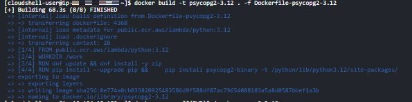
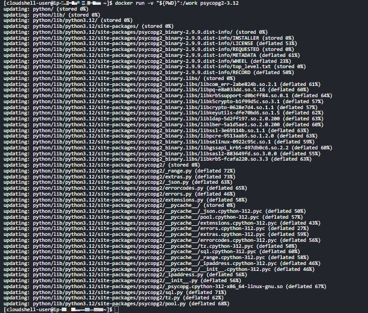
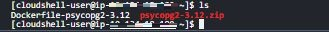
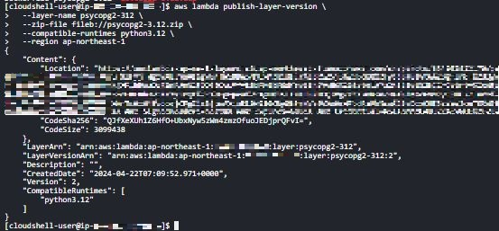
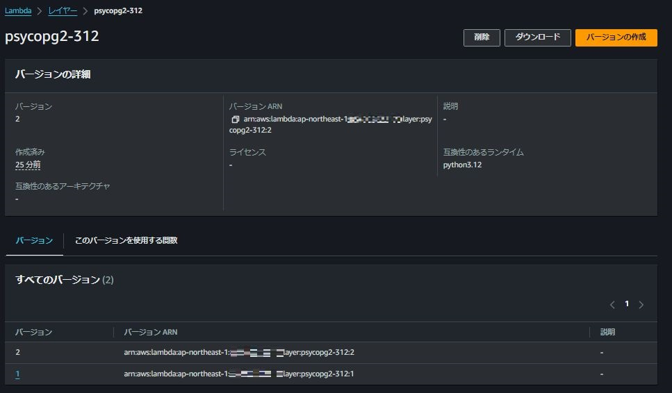

<!--# psycopg2 の Lambda レイヤーを作成する<!-- omit in toc -->

## ☘️ はじめに<!-- omit in toc -->

本ページは、AWS に関する個人の勉強および勉強会で使用することを目的に、AWS ドキュメントなどを参照し作成しておりますが、記載の誤り等が含まれる場合がございます。

最新の情報については、AWS 公式ドキュメントをご参照ください。

## 👀 Contents<!-- omit in toc -->

- [経緯](#経緯)
- [手順](#手順)
  - [1.Docker ファイルを作成](#1docker-ファイルを作成)
  - [2.イメージをビルドして、zip ファイルを生成](#2イメージをビルドしてzip-ファイルを生成)
  - [3.Lambda レイヤーを登録](#3lambda-レイヤーを登録)
- [まとめ](#まとめ)

## 経緯

AWS より下記通知があり、Python 3.12 にバージョンアップしようとしました。
ただ、これまで使用していた[arn:aws:lambda:ap-northeast-1:898466741470:layer:psycopg2-py38:1](https://github.com/jetbridge/psycopg2-lambda-layer)という Lambda レイヤーが、どうやら 3.9 までしか配布がないようでした。
そこで、Python 3.12 用を自作することになりました。

```text
We are ending support for Python 3.8 in Lambda on October 14, 2024.
This follows Python 3.8 End-Of-Life (EOL) which is scheduled for October, 2024
```

[Status of Python versions](https://devguide.python.org/versions/)

## 手順

CloudShell 上で次の手順を実施します。

1.Docker ファイルを作

2.イメージをビルドして、zip ファイルを生成

3.Lambda レイヤーを登録

### 1.Docker ファイルを作成

```sh:Dockerfile-psycopg2-3.12
FROM public.ecr.aws/lambda/python:3.12

WORKDIR /work

# システム更新と必要なパッケージのインストール
RUN dnf update && dnf install -y zip

RUN pip install --upgrade pip && \
    pip install psycopg2-binary -t /python/lib/python3.12/site-packages/
ENTRYPOINT [""]
CMD zip -r psycopg2-3.12.zip /python/
```

### 2.イメージをビルドして、zip ファイルを生成

```sh
docker build -t psycopg2-3.12 . -f Dockerfile-psycopg2-3.12
```



```sh
docker run -v "${PWD}":/work psycopg2-3.12
```



psycopg2-3.12.zip が生成されました。



### 3.Lambda レイヤーを登録

生成した psycopg2-3.12 を Lambda レイヤーに登録します。（画像ではコマンド実行が 2 回目なのでレスポンスのバージョンが 2 になっています）

```sh
aws lambda publish-layer-version \
  --layer-name psycopg2 \
  --zip-file fileb://psycopg2-3.12.zip \
  --compatible-runtimes python3.12 \
  --region ap-northeast-1
```



マネジメントコンソールでも登録されていることが確認できました。（画像では 2 回目なのでバージョン 2 が生成されています）



## まとめ

CloudShell ではデフォルトで Docker コマンドが使えるため、手軽に実施できます。