# AWS Lambda<!-- omit in toc -->


## ☘️ はじめに<!-- omit in toc -->

本ページは、AWS に関する個人の勉強および勉強会で使用することを目的に、AWS ドキュメントなどを参照し作成しておりますが、記載の誤り等が含まれる場合がございます。

最新の情報については、AWS 公式ドキュメントをご参照ください。

## 👀 Contents<!-- omit in toc -->

- [AWS Lambda とは](#aws-lambda-とは)
- [ネットワーク](#ネットワーク)
- [実行環境](#実行環境)
  - [コールドスタート問題](#コールドスタート問題)
  - [SnapStart](#snapstart)
- [命令セットアーキテクチャ](#命令セットアーキテクチャ)
- [Lambda のアクセス権限](#lambda-のアクセス権限)
- [トリガー](#トリガー)
  - [Pull モデル](#pull-モデル)
  - [Push モデル](#push-モデル)
- [呼び出しタイプ](#呼び出しタイプ)
- [対応ランタイム](#対応ランタイム)
- [Layer](#layer)
- [デプロイパッケージ](#デプロイパッケージ)
  - [コンソール](#コンソール)
  - [CloudFormation](#cloudformation)
  - [AWS CDK](#aws-cdk)
  - [AWS SAM](#aws-sam)
- [エフェメラルストレージ(一時領域)](#エフェメラルストレージ一時領域)
- [同時実行](#同時実行)
- [Qualifier](#qualifier)
- [関数 URL](#関数-url)
- [モニタリング](#モニタリング)
- [ベストプラクティス](#ベストプラクティス)
- [クォータ](#クォータ)
- [📖 まとめ](#-まとめ)

## AWS Lambda とは

<!-- Duration: 4:01:22 -->

サーバーをプロビジョニングまたは管理せずにコードを実行できるようにするコンピューティングサービスです。FaaS(Function as a Service：ファース、エフアース)に分類されるサービスです。

2026 年 10 月に Lambda Web Functions が登場し、Lambda のコンピュートプリミティブは Event Functions、Web Functions、MicroVMs の 3 種類になりました。従来の Lambda 関数は Event Functions と呼ばれるようになりましたが、変わったのは呼称だけで、API、`AWS::Lambda::Function`、ARN、コードはそのままです。本ページの内容は Event Functions についての説明です。3 種類の違いは [AWS Lambda の 3 つのコンピュートプリミティブ比較](./lambda-event-vs-web-vs-microvms.md) を参照してください。

【AWS Black Belt Online Seminar】[AWS Lambda Part1(YouTube)](https://www.youtube.com/watch?v=QvPgjEwgiew)(1:02:22)

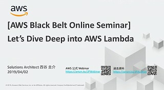

【AWS Black Belt Online Seminar】[AWS Lambda Part2(YouTube)](https://www.youtube.com/watch?v=96ku2x1NCaE)(1:01:17)

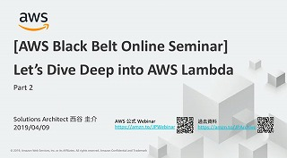

【AWS Black Belt Online Seminar】[AWS Lambda Part3(YouTube)](https://www.youtube.com/watch?v=rMG18Fr896U)(1:01:15)

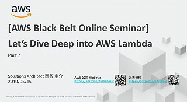

【AWS Black Belt Online Seminar】[AWS Lambda Part4(YouTube)](https://www.youtube.com/watch?v=AOx5iNmxOC8)(56:28)

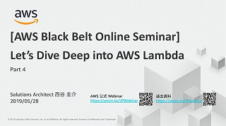

[チュートリアル: Amazon S3 トリガーを使用して Lambda 関数を呼び出す](https://docs.aws.amazon.com/ja_jp/lambda/latest/dg/with-s3-example.html)
[チュートリアル: API Gateway で Lambda を使用する](https://docs.aws.amazon.com/ja_jp/lambda/latest/dg/services-apigateway-tutorial.html)
[チュートリアル: スケジュールされたイベントでの AWS Lambda の使用](https://docs.aws.amazon.com/ja_jp/lambda/latest/dg/services-cloudwatchevents-tutorial.html)

[AWS Lambda サービス概要](https://aws.amazon.com/jp/lambda/)

[AWS Lambda ドキュメント](https://docs.aws.amazon.com/ja_jp/lambda/?id=docs_gateway)

[AWS Lambda よくある質問](https://aws.amazon.com/jp/lambda/faqs/)

[AWS Lambda 料金](https://aws.amazon.com/jp/lambda/pricing/)

## ネットワーク

<!-- Duration: 0:01:00 -->

Lambda は Lambda サービスが所有する VPC 内で実行されています。
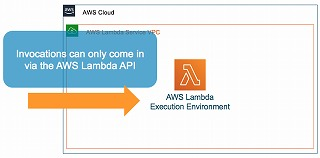

Lambda を自 VPC に接続すると、Lambda サービスの VPC と自 VPC を接続するために Hyperplane ENI(Elastic Network Interface)を作成し、関数に割り当てます。

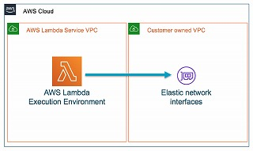

## 実行環境

<!-- Duration: 0:01:30 -->

https://docs.aws.amazon.com/ja_jp/lambda/latest/dg/lambda-runtime-environment.html

安全で分離されたランタイムを実行するための環境で、実行環境のライフサイクルは次のようになっています。

- 通常
  - INIT(初期化) → INVOKE（呼び出し） → SHUTDOWN（シャットダウン）
- SnapStart を利用している場合
  - RESTORE(復元) → INVOKE（呼び出し） → SHUTDOWN（シャットダウン）

### コールドスタート問題

生成された Lambda 関数インスタンスは、一定時間後に消失します。消失するまでの間は実行環境が再利用されることがありますが、そうでない場合は、初期化から開始します。

実行頻度が低い関数の実行時に毎回起動時間がかかってしまうことです。

- コンパイルが必要な言語で作成された関数は、コンパイル時間も毎回必要になります。
  - 「プロビジョニングされた同時実行」という機能がなかったときは、定期実行をして、コールドスタートの発生確率を下げる方法でした。
  - 「プロビジョニングされた同時実行」にすることで、予めプロビジョニングされた状態にできます。ただし、Lambda の特徴である「関数が実行された時間だけ」課金されるメリットが失われ、「プロビジョニングされていた時間」の課金となります。
- VPC Lambda は ENI の起動が必要になるため遅い。
  - ENI は作成までに 10 秒以上かかることがある
  - 2019/09 以前は、関数ごとに ENI が作成されており、実行環境がスケールしてリクエストが増加するにつれて、多くの ENI が作成されるようになっていました。ENI 数に比例して サブネットに割り当てた IP アドレスを消費してしまいます。
    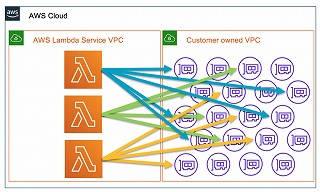
  - 現在は、事前に作成した 共通利用する ENI を利用して VPC に接続しているため ENI の作成に関する問題は解消されました。

### SnapStart

https://docs.aws.amazon.com/ja_jp/lambda/latest/dg/snapstart.html

https://aws.amazon.com/jp/blogs/news/reducing-java-cold-starts-on-aws-lambda-functions-with-snapstart/

Lambda の起動時のレイテンシー（主に、コールドスタート時間）の最大要因は関数の初期化です。
それを解消するために、関数のバージョンを発行するときに関数を初期化し、その実行環境（メモリとディスク状態）のスナップショットをキャッシュさせ、キャッシュさせたスナップショットから実行環境を再開することで起動時のレイテンシーが短縮される機能です。

対応ランタイムは Java 11 以降、Python 3.12 以降、.NET 8 以降で、公開バージョンとそれを指すエイリアスでのみ動作します。Java には追加料金がありませんが、Python と .NET はスナップショットのキャッシュ（Caching）と復元（Restoration）に課金されます。

次の機能とは併用できません。

- プロビジョニングされた同時実行
- Amazon EFS、Amazon S3 Files
- 512 MB を超えるエフェメラルストレージ

## 命令セットアーキテクチャ

<!-- Duration: 0:00:30 -->

https://docs.aws.amazon.com/ja_jp/lambda/latest/dg/foundation-arch.html

- arm64 — AWS Graviton プロセッサ用の 64 ビット ARM アーキテクチャ
  - アームろくよん
  - x86_64 アーキテクチャと比べて、コストパフォーマンスが最大 34% 向上する
  - 実際のコストは 東京リージョンでは 20%ほど低い。
  - 利用できる場合は、こちらを選ぶ。
- x86_64 — x86 ベースプロセッサ用の 64 ビット x86 アーキテクチャ
  - エックスはちろく・ろくよん

それぞれの違いは、このあたりを参考に。
ARM と x86：その違い：https://www.redhat.com/ja/topics/linux/ARM-vs-x86

## Lambda のアクセス権限

<!-- Duration: 0:01:00 -->

Lambda のアクセス権限には、IAM ロール（＝実行ロールと呼ばれます。ロールの中には、IAM ポリシーが含まれます）とリソースベースのポリシーがあります。

実行ロールでは、Lambda 関数が他のリソースにアクセスできる権限や実行をまかせるための信頼ポリシーを記述するロールで、Lambda 関数を作成する際には必ず付与します。

リソースポリシーでは、どのサービスやアカウントが Lambda 関数を呼び出せるかを記述します。後述する Push モデルのトリガー（S3, CloudWatch など）を使用する場合に指定します。

[IAM ロールとリソースベースのポリシーとの相違点](https://docs.aws.amazon.com/ja_jp/IAM/latest/UserGuide/id_roles_compare-resource-policies.html)

| Key       | IAM ポリシー             | リソースポリシー                                             |
| --------- | ------------------------ | ------------------------------------------------------------ |
| Resource  | 適用対象のリソースの ARN | 適用対象のリソースの ARN                                     |
| Action    | オペレーション           | オペレーション                                               |
| Effect    | Allow or Deny            | Allow or Deny                                                |
| Principal | ×                        | 権限を受け取りたいエンティティ(サービス、アカウント、ユーザ) |

## トリガー

<!-- Duration: 0:01:30 -->

Pull モデルと Push モデルがあります。

### Pull モデル

Pull モデルは、ポーリング型の実行です。Lambda の[イベントソースマッピング](https://docs.aws.amazon.com/ja_jp/lambda/latest/dg/invocation-eventsourcemapping.html)で指定されたイベントソースをポーリングして読み取りを行うものです。イベントは一度ストリームまたはキューに格納されます。DynamoDB や Kinesis のストリームではシャード単位で順序が保たれますが、SQS 標準キューのように順序が保証されないソースもあります。配信は at-least-once のため、同じイベントが重複して処理される場合があります。
以下のサービスとの連携が対象です。

- Amazon DocumentDB
- Amazon DynamoDB
- Amazon Kinesis
- Amazon MQ
- Amazon Managed Streaming for Apache Kafka (Amazon MSK)
- セルフマネージド Apache Kafka
- Amazon Simple Queue Service (Amazon SQS)

### Push モデル

Push モデルは、イベント駆動型の実行です。Lambda がイベントソースから直接呼び出されるものです。発生したイベントの実行順序は保証されていません。発生したイベントの順番に処理される場合もありますし、タイミングによっては前後する場合もあります。
イベントソースとなるサービスによって、Lambda の呼び出しタイプ（同期、非同期）が決まっています。

主に以下のようなサービスがあります。

- Amazon S3（非同期）
- Amazon CloudWatch（非同期）
- Amazon SNS（非同期）
- Amazon Cognito（同期）
- Amazon API Gateway（同期）

## 呼び出しタイプ

<!-- Duration: 0:01:30 -->

AWS SDK や CLI から実行する際に、`InvocationType` を指定することでコントロールできます。

- RequestResponse

  - デフォルト
  - 同期実行
  - 直接 Lambda を 1 回実行し、処理が完了したらレスポンスが返ってきます。

  ```sh
  aws lambda invoke --function-name hoge-function \
  --payload .... response.json

  # Response
  {
        "StatusCode": 200,
        "ExecutedVersion": "$LATEST",
        "FunctionError": "...."
  }
  ```

- Event

  - 非同期実行
  - Lambda の実行はキューイングされます。
  - キューイングされたタイミングでレスポンスが返ってきます。
  - 失敗した場合自動的に 2 回までリトライされます。
  - DLQ（デッドレターキュー）で、失敗した場合の設定が行えます。

  ```sh
  aws lambda invoke --function-name hoge-function \
  --invocation-type Event --payload .... response.json

  # Response
  {
        "StatusCode": 202
  }
  ```

- DryRun

  - 関数を実行しないで必要な権限が付いているか確認できます。

  ```sh
  aws lambda invoke --function-name hoge-function \
  --invocation-type DryRun --payload .... response.json

  # Response
  {
        "StatusCode": 204
  }
  ```

## 対応ランタイム

<!-- Duration: 0:01:30 -->

https://docs.aws.amazon.com/ja_jp/lambda/latest/dg/lambda-runtimes.html

2026 年 11 月時点の主なマネージドランタイムは次のとおりです。

- Node.js
  - 24, 22（26 はパブリックプレビュー）
- Python
  - 3.14, 3.13, 3.12, 3.11（3.15 はプレビュー）
- Java
  - 25, 21, 17, 11, 8
- .NET
  - 10, 8（8 は 2026-11-10 に非推奨予定）
- Ruby
  - 4.0, 3.4, 3.3
- OS 専用ランタイム
  - `provided.al2023` など。Go や Rust はこちらを使う

ランタイムの非推奨化は、次の順に進みます。

- Deprecation date（非推奨日）
  - セキュリティパッチの更新が停止し、サポート対象外になる
  - コンソールから新規作成できなくなる
- Block function create（関数の作成をブロック）
  - 非推奨日から少なくとも 30 日後
- Block function update（関数の更新をブロック）
  - 非推奨日から少なくとも 60 日後

どの段階でも、既存関数の呼び出しは継続できます。ただしサポートされているランタイムへの移行が必要です。

非推奨の少なくとも 180 日前に E メールで通知され、[Trusted Advisor](https://docs.aws.amazon.com/ja_jp/awssupport/latest/user/security-checks.html#aws-lambda-functions-deprecated-runtimes) でも同じ時期からチェックできます。

## Layer

<!-- Duration: 0:01:00 -->

https://docs.aws.amazon.com/ja_jp/lambda/latest/dg/configuration-layers.html

Lambda 関数で使用するライブラリとその他の依存関係をパッケージ化できる機能です。関数には最大で 5 つのレイヤーを含めることができます。
レイヤーを使用することで、デプロイパッケージのサイズを削減し、デプロイスピードを速めることができます。

## デプロイパッケージ

<!-- Duration: 0:03:00 -->

関数をデプロイするには、関数コードと依存関係を含む .zip ファイルまたは、[Open Container Initiative](https://opencontainers.org/) (OCI) の仕様に準拠したコンテナーイメージでデプロイできます。

Lambda 関数を作成するには、次の方法があります。

- コンソール上でコードを記述
- CloudFormation
- AWS CDK
- AWS SAM

### コンソール

https://docs.aws.amazon.com/ja_jp/lambda/latest/dg/getting-started.html

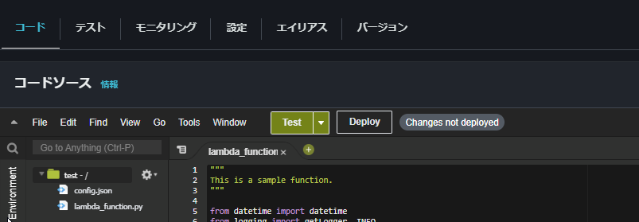

### CloudFormation

CloudFormation で関数をデプロイするには、次の方法があります。

- S3 バケットにコードの .zip ファイルをアップロードする

  ```yaml
  Resources:
    Function1:
      Type: AWS::Lambda::Function
      Properties:
        Code:
          S3Bucket: !Ref S3Bucket
          S3Key: !Ref S3Key
        Environment:
  ```

- CloudFormation の YAML ファイルにインラインで記述する（コードの依存関係がない場合のみ）

  ```yaml
  Resources:
    Function2:
      Type: AWS::Lambda::Function
      Properties:
        Code:
          ZipFile: |
            import boto3
            import json
            import os

            def lambda_handler(event, context):
            :
  ```

- コンテナイメージから

  ```yaml
  Resources:
  Function3:
    Type: AWS::Lambda::Function
    Properties:
      Code:
        ImageUri: !Ref ImageUri
  ```

### AWS CDK

```ts
    const Function1 = new lambda.Function(
      this,
      'Function1',
      {
        functionName: "Function1",
        description: 'comment....',
        code: lambda.Code.fromAsset(
          path.join(__dirname, `${srcLambdaDirBase}/hello_world`)
        ),
        handler: 'index.lambda_handler',
        runtime: lambda.Runtime.PYTHON_3_13,
        timeout: cdk.Duration.seconds(300),
        architecture: lambda.Architecture.ARM_64,
        environment: {
          LOG_LEVEL: props.lambdaLogLevel ?? 'INFO',
          :
        },
        role: xxxx,
        tracing: lambda.Tracing.ACTIVE,
      }
    );
```

### AWS SAM

AWS Serverless Application Model (AWS SAM) でデプロイするには次のようにします。

```yaml
Function1:
  Type: AWS::Serverless::Function
  Properties:
    CodeUri: hello_world/
    Handler: app.lambda_handler
    Runtime: python3.13
    Architectures:
      - arm64
```

## エフェメラルストレージ(一時領域)

<!-- Duration: 0:00:30 -->

AWS Lambda で最大 10 GB のエフェメラルストレージをサポート可能に
https://aws.amazon.com/jp/blogs/news/aws-lambda-now-supports-up-to-10-gb-ephemeral-storage/

512 MB ～ 10 GB まで `/tmp` 領域を作成できます。

## 同時実行

<!-- Duration: 0:00:30 -->

ある時点で実行されているリクエストの数のことです。
Lambda 関数の同時実行数のクォータは、同一アカウントの同一リージョン内で既定 1,000 です。新規アカウントではこれより低い値から始まり、利用状況に応じて自動で引き上げられます。
Lambda の同時実行数の計測は以下のように考えます。

```text
同時実行=（1秒あたりの呼び出し数）x（平均実行時間（秒））
```

Lambda 関数が平均 10 秒かかり、1 秒あたり 100 個のイベントを発行すると Lambda 関数を 1000 同時に実行することになり、制限ぎりぎりとなります。

## Qualifier

<!-- Duration: 0:01:00 -->

https://docs.aws.amazon.com/ja_jp/lambda/latest/dg/configuration-aliases.html

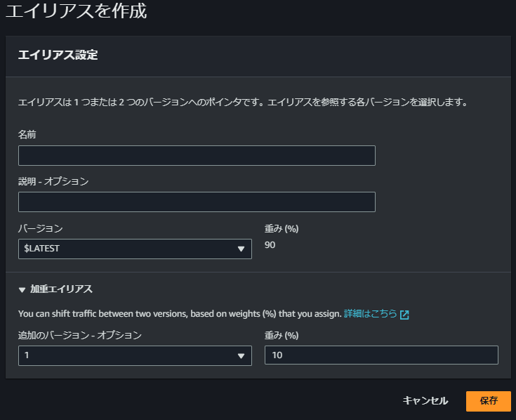

関数を呼び出す場合のバージョン（my-function:1）やエイリアス（my-function:BLUE）を指定できます。
エイリアス作成時に`Weighted alias (加重エイリアス)`を指定することで、リクエストの振り分けに重みをつけることができます。
ほとんどのトラフィックを既存バージョンに振り分けて一部のトラフィックを新しいバージョンに振り分けるといったことができます。これにより、新しいバージョンを展開するリスクを軽減できます。

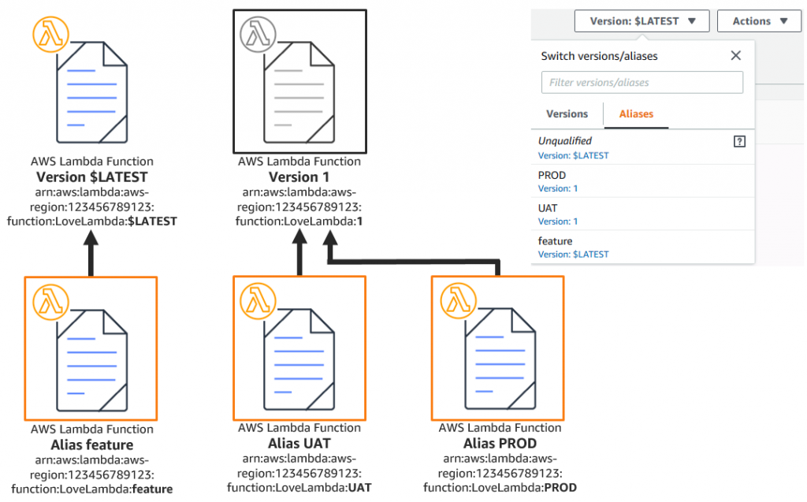

## 関数 URL

<!-- Duration: 0:01:00 -->

https://docs.aws.amazon.com/ja_jp/lambda/latest/dg/lambda-urls.html

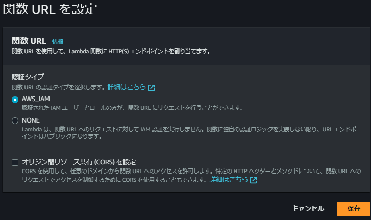

関数を呼び出すための HTTPS エンドポイントが作成できます。

APIGateway を作成しなくても、HTTPS の URL を利用することができます。

```sh
https://<url-id>.lambda-url.<region>.on.aws
```

このエンドポイントには、IAM 認証も付けることができます。
IAM 認証を付けた場合は、`AWS Signature Version 4 (SigV4) `による署名が必要です。詳しくは下記ドキュメントを参照してください。
https://docs.aws.amazon.com/ja_jp/lambda/latest/dg/urls-invocation.html

## モニタリング

<!-- Duration: 0:01:30 -->

https://docs.aws.amazon.com/ja_jp/lambda/latest/dg/lambda-monitoring.html

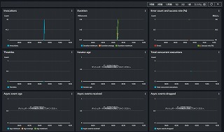

監視するメトリクスとしては次のようなものがあります。

- Invocations
  このメトリクスは監視間隔として 300 秒(5 分)若しくは 60 秒(1 分)を設定してください。監視の際には、statistics として「Sum」を利用することを推奨します。
- Errors
  このメトリクスは監視間隔として 300 秒(5 分)若しくは 60 秒(1 分)を設定してください。監視の際には、statistics として「Sum」を利用することを推奨します。
- Throttles
  このメトリクスは監視間隔として 300 秒(5 分)若しくは 60 秒(1 分)を設定してください。監視の際には、statistics として「Sum」を利用することを推奨します。

その他、Lambda 関数のメモリをモニタリングしたい場合は、次のドキュメントを参照します。
https://aws.amazon.com/jp/premiumsupport/knowledge-center/lambda-function-memory-usage-monitoring/

## ベストプラクティス

<!-- Duration: 0:01:00 -->

https://docs.aws.amazon.com/ja_jp/lambda/latest/dg/best-practices.html

主なベストプラクティスは次の通りです。

- Lambda ハンドラーをコアロジックから分離
  - `lambda_handler` の中にロジックを全て記述しないで、メソッド分割する。
  - 単体テストがしやすい、コードの可読性が向上する、など。
- ランタイムを必要最低限にしてサイズを小さく
  - 起動時間にも影響するので最小限に
- レイヤー使う
  - 共通化しよう
- 再帰呼び出しを行わない
  - 意図しない処理で料金が急増するリスクがあるため
- 環境変数を使う
  - ハードコーディングしない。
- 冪等性のコード
  - Lambda が重複して実行されることも考慮しておく。

## クォータ

<!-- Duration: 0:00:30 -->

https://docs.aws.amazon.com/ja_jp/lambda/latest/dg/gettingstarted-limits.html

主に、同時実行数を引き上げたいなど。

## 📖 まとめ

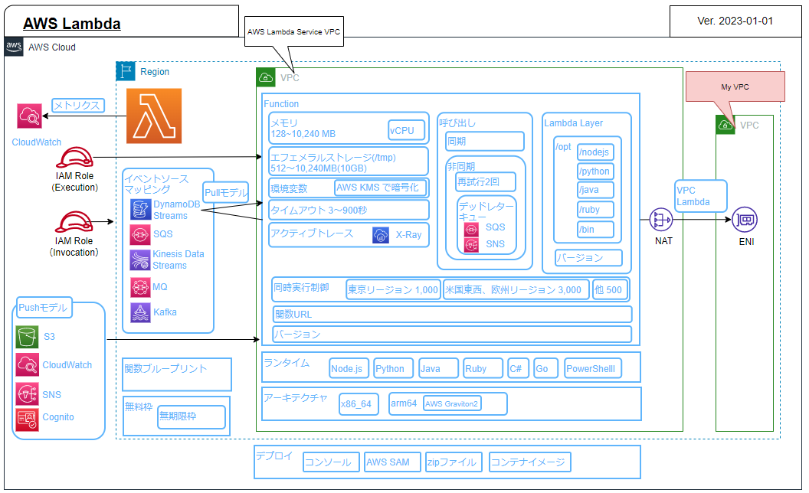