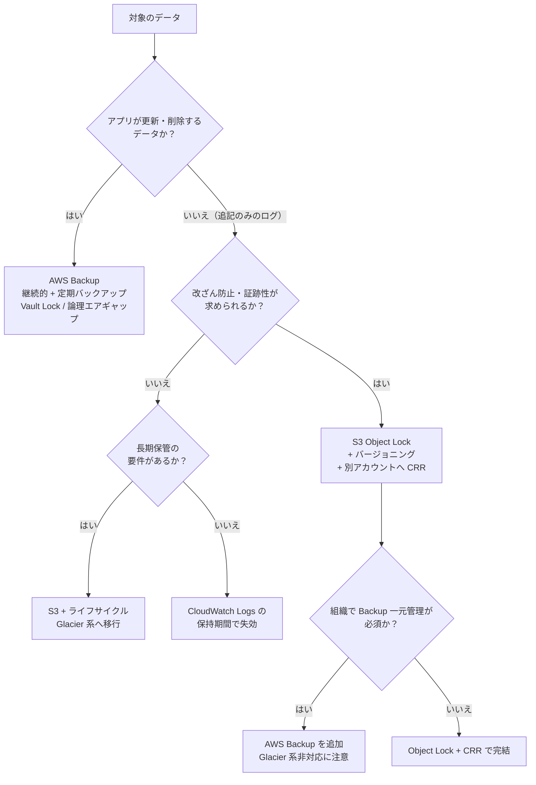

# AWS のログ保管設計 ～ バックアップするログとロックするログの判断基準<!-- omit in toc -->

## ☘️ はじめに<!-- omit in toc -->

本ページは、AWS に関する個人の勉強および勉強会で使用することを目的に、AWS ドキュメントなどを参照し作成しておりますが、記載の誤り等が含まれる場合がございます。

最新の情報については、AWS 公式ドキュメントをご参照ください。

実プロジェクトでログのアーカイブやバックアップを設計していると、「このログは AWS Backup の対象にすべきか」「Object Lock で消せないようにすべきか」「CloudWatch Logs に何日置けばよいか」といった判断で手が止まることがあります。本記事では、基本的な Web アプリケーション構成で出てくるログを対象に、判断の軸と設計例を整理します。

## 👀 Contents<!-- omit in toc -->

- [1. 「アーカイブ」「バックアップ」「イミュータブル保管」は目的が違う](#1-アーカイブバックアップイミュータブル保管は目的が違う)
- [2. 対象とするログと出力先](#2-対象とするログと出力先)
  - [2.1. 追加で検討したいログ](#21-追加で検討したいログ)
  - [2.2. サービス側の保持期間には上限がある](#22-サービス側の保持期間には上限がある)
- [3. ログを 3 つに分類して要件を決める](#3-ログを-3-つに分類して要件を決める)
- [4. CloudWatch Logs の保持期間設計](#4-cloudwatch-logs-の保持期間設計)
  - [4.1. 既定は「失効しない」](#41-既定は失効しない)
  - [4.2. CloudWatch Logs に WORM 機能はない](#42-cloudwatch-logs-に-worm-機能はない)
  - [4.3. S3 への転送方法](#43-s3-への転送方法)
  - [4.4. 保持期間の決め方](#44-保持期間の決め方)
- [5. S3 Object Lock + バージョニング + CRR](#5-s3-object-lock--バージョニング--crr)
  - [5.1. Object Lock の基本](#51-object-lock-の基本)
  - [5.2. 削除マーカーとライフサイクル](#52-削除マーカーとライフサイクル)
  - [5.3. レプリケーション（CRR）との組み合わせ](#53-レプリケーションcrrとの組み合わせ)
  - [5.4. Object Lock で防げないもの](#54-object-lock-で防げないもの)
  - [5.5. 小さいログファイルとストレージクラス](#55-小さいログファイルとストレージクラス)
- [6. AWS Backup で S3 を保護する場合](#6-aws-backup-で-s3-を保護する場合)
- [7. Object Lock + CRR と AWS Backup の使い分け](#7-object-lock--crr-と-aws-backup-の使い分け)
  - [7.1. 監査ログに AWS Backup はほぼ不要](#71-監査ログに-aws-backup-はほぼ不要)
  - [7.2. S3 の業務データは逆に AWS Backup が向いている](#72-s3-の業務データは逆に-aws-backup-が向いている)
  - [7.3. 判断フロー](#73-判断フロー)
- [8. マルウェアの潜伏期間と保持期間](#8-マルウェアの潜伏期間と保持期間)
  - [8.1. 潜伏期間の統計](#81-潜伏期間の統計)
  - [8.2. ログでは「さかのぼって調査できる期間」として効く](#82-ログではさかのぼって調査できる期間として効く)
  - [8.3. データバックアップでは「クリーンな世代を残す期間」として効く](#83-データバックアップではクリーンな世代を残す期間として効く)
- [9. ログ種別ごとの設計例](#9-ログ種別ごとの設計例)
- [10. 落とし穴](#10-落とし穴)
- [11. 方針を決めるためのチェックリスト](#11-方針を決めるためのチェックリスト)
- [📖 まとめ](#-まとめ)
- [参考資料](#参考資料)

## 1. 「アーカイブ」「バックアップ」「イミュータブル保管」は目的が違う

<!-- Duration: 00:03:00 -->

ログの保管方式で迷う原因の多くは、3 つの目的を区別しないまま「バックアップ」とひとまとめに呼んでいることにあります。

| 目的 | 守りたいもの | 典型的な手段 | 「復元」の概念 |
| --- | --- | --- | --- |
| アーカイブ | 長期間・低コストで残すこと | S3 ライフサイクルで Glacier 系へ移行 | ほぼない（読み出すだけ） |
| バックアップ | 壊れた・消えたデータを過去の時点に戻すこと | AWS Backup、スナップショット | ある（元の場所や別リソースへ戻す） |
| イミュータブル保管 | 削除・改ざんされていないこと | S3 Object Lock、Backup Vault Lock | ない（消えないことが価値） |

アプリケーションのデータは更新され続けるため、誤操作やランサムウェアで壊れた場合に「壊れる前」へ戻す必要があります。これがバックアップの役割です。

一方、ログは基本的に追記のみのデータで、一度書かれたレコードを後から書き換える運用はしません。ログで問題になるのは「壊れること」よりも「消されること」「改ざんされること」「必要な期間が経つ前に失効すること」です。この違いを押さえると、ログに対して AWS Backup が必要になる場面はかなり限られることが分かります。

## 2. 対象とするログと出力先

<!-- Duration: 00:05:00 -->

本記事では、ALB + EC2 / ECS Fargate + Aurora を CloudFront と AWS WAF で公開する、よくある Web アプリケーション構成を想定します。各ログの主な出力先は次のとおりです。

| ログ | 主な出力先 | 補足 |
| --- | --- | --- |
| AWS CloudTrail（証跡） | S3（必須）、CloudWatch Logs（任意） | イベント履歴は証跡がなくても管理イベントを 90 日間参照できる |
| AWS Config | S3（設定履歴・スナップショット） | 設定項目の履歴は Config 内にも保持される。Object Lock 有効バケットへの配信は非対応 |
| Amazon GuardDuty（検出結果） | S3 へのエクスポート、EventBridge | S3 エクスポートには KMS キーが必須 |
| AWS Security Hub CSPM（検出結果） | EventBridge 経由で Firehose → S3 など | ネイティブの S3 エクスポート機能はない |
| Aurora（RDS）のログ | CloudWatch Logs | Aurora MySQL は audit / error / general / slowquery、Aurora PostgreSQL は postgresql など |
| ALB アクセスログ | S3 のみ | バケットの暗号化は SSE-S3 のみ対応 |
| AWS WAF ログ | CloudWatch Logs、S3、Firehose | 出力先の名前は `aws-waf-logs-` で始める必要がある |
| CloudFront 標準ログ | v2: CloudWatch Logs、S3、Firehose / レガシー: S3 | レガシー方式は ACL が有効なバケットが必要 |
| EC2 の OS ログ | CloudWatch Logs（CloudWatch エージェント） | エージェント導入と設定が必要 |
| Session Manager のセッションログ | S3、CloudWatch Logs | セッションの開始・終了 API 自体は CloudTrail に記録される |
| ECS Fargate のコンテナログ | CloudWatch Logs（`awslogs`）、FireLens 経由で Firehose / S3 など | タスク定義のログドライバーで指定する |

💡 Aurora の監査をより厳密に行いたい場合は、データベースアクティビティストリーム（Kinesis Data Streams へ配信）も選択肢になります。

### 2.1. 追加で検討したいログ

インシデント調査では「誰が（CloudTrail）」「どこと通信したか」「何を名前解決したか」を突き合わせることが多いため、次の 2 つも対象に含めることをおすすめします。

| ログ | 主な出力先 | 調査での用途 |
| --- | --- | --- |
| VPC フローログ | CloudWatch Logs、S3、Firehose | 外部 C2 サーバーとの通信や横展開の痕跡を追う |
| Route 53 Resolver クエリログ | CloudWatch Logs、S3、Firehose | 不審なドメインへの名前解決（DNS トンネリング等）を追う |

「DNS ログ」と書くと、Route 53 のパブリックホストゾーンのクエリログを指す場合もあります。こちらは外部から自社ドメインへの問い合わせの記録で、VPC 内のリソースが何を名前解決したかは分かりません。侵害調査で必要になるのは Resolver クエリログの方です。

S3 に重要データを置く場合は、オブジェクト単位の操作を残す CloudTrail の S3 データイベントも検討対象です。S3 サーバーアクセスログもありますが、後述のとおり Object Lock を有効にしたバケットを出力先にできません。

### 2.2. サービス側の保持期間には上限がある

GuardDuty、Security Hub CSPM、CloudTrail のイベント履歴は、何もしなくてもコンソールで過去の情報を参照できます。ただし保持期間には上限があり、延長できません。

| サービス | サービス側での保持 |
| --- | --- |
| CloudTrail イベント履歴 | 管理イベントを 90 日間 |
| GuardDuty | 検出結果を 90 日間 |
| Security Hub CSPM | アクティブな検出結果は最終更新から 90 日、アーカイブ済みは 30 日 |
| AWS Config | 設定項目の履歴を 30〜2,557 日の範囲で設定可能 |

90 日を超えて調査や監査に使う可能性があるなら、S3 へのエクスポートを最初から設計に入れておく必要があります。

## 3. ログを 3 つに分類して要件を決める

<!-- Duration: 00:03:00 -->

ログ種別ごとに個別に悩むより、まず性質の近いものをまとめて要件を決めた方が判断がぶれません。

| 分類 | 該当するログ | 改ざん防止 | 保持期間の目安 | 即時検索性 |
| --- | --- | --- | --- | --- |
| A. 監査・証跡系 | CloudTrail、Config、Session Manager、Aurora の監査ログ | 必須 | 規制・社内規程に従う（1 年以上が多い） | 直近数か月のみ |
| B. セキュリティ分析系 | GuardDuty、Security Hub CSPM、WAF、VPC フローログ、Resolver クエリログ、ALB / CloudFront アクセスログ | 推奨 | 潜伏期間 + 調査期間をカバーする長さ（後述） | 直近数週間〜数か月 |
| C. 運用・トラブルシュート系 | EC2 の OS ログ、ECS アプリログ、Aurora の error / slowquery ログ | 任意 | 障害調査に必要な長さ（数週間〜数か月） | 高い |

分類 A は「消されていない・改ざんされていないことを第三者に示せる」ことが価値の中心です。分類 C は調査が終われば価値が下がるため、保管コストを抑えることを優先します。分類 B はその中間で、セキュリティインシデントの調査材料として、ある程度長く改ざんされずに残っていることが求められます。

基準として PCI DSS v4.0 の要件 10.5.1 がよく引き合いに出されます。監査ログを少なくとも 12 か月保持し、直近 3 か月分はすぐに分析できる状態にしておく、という内容です。準拠対象でなくても、分類 A・B の初期値として「12 か月保持・直近 3 か月はすぐ検索可能」から検討を始めると合意を取りやすくなります。

## 4. CloudWatch Logs の保持期間設計

<!-- Duration: 00:05:00 -->

### 4.1. 既定は「失効しない」

ロググループを作成した時点では保持期間が設定されておらず、ログは無期限に保存されます。RDS のログ発行や ECS の `awslogs` ドライバーが自動作成したロググループも同様です。放置するとストレージ料金が積み上がり続けるため、ロググループ作成時に必ず保持期間を設定する運用にします。

設定できる値は次の 22 段階で、任意の日数は指定できません。

```text
1, 3, 5, 7, 14, 30, 60, 90, 120, 150, 180, 365, 400, 545, 731, 1096, 1827, 2192, 2557, 2922, 3288, 3653（日）
```

```sh
aws logs put-retention-policy \
  --log-group-name /aws/rds/cluster/my-aurora-cluster/audit \
  --retention-in-days 90
```

💡 AWS Config のマネージドルール `cw-loggroup-retention-period-check` を使うと、保持期間が基準（既定は 365 日）より短いロググループを検出できます。ただし保持期間が未設定（失効しない）のロググループは「準拠」と判定されるため、未設定の検出には使えません。未設定を防ぐには、IaC でロググループを明示的に作成し保持期間を指定する運用が確実です。

ロググループには Standard と Essentials（旧称 Infrequent Access）の 2 つのログクラスがあります。Essentials は取り込み料金が安い代わりに、サブスクリプションフィルターやメトリクスフィルター、Live Tail などが使えません。ログクラスは作成後に変更できないため、「S3 へ転送するロググループ」を Essentials にするとサブスクリプションフィルターが使えず困ることになります。

### 4.2. CloudWatch Logs に WORM 機能はない

CloudWatch Logs には、Object Lock のようにログを一定期間削除不可にする機能がありません。`logs:DeleteLogGroup` や `logs:PutRetentionPolicy` の権限を持つプリンシパルであれば、ロググループの削除や保持期間の短縮ができてしまいます。

そのため、改ざん防止が必要な分類 A・B のログについては、CloudWatch Logs を「直近の検索・アラート用」と位置づけ、長期保管と改ざん防止は S3 側で担う構成が基本になります。CloudWatch Logs 側は SCP で削除や保持期間変更を制限しておくと、運用ミスや侵害時の証拠隠滅を防ぎやすくなります。

```json
{
  "Version": "2012-10-17",
  "Statement": [
    {
      "Sid": "DenyLogTampering",
      "Effect": "Deny",
      "Action": [
        "logs:DeleteLogGroup",
        "logs:DeleteLogStream",
        "logs:PutRetentionPolicy"
      ],
      "Resource": "*",
      "Condition": {
        "ArnNotLike": {
          "aws:PrincipalArn": "arn:aws:iam::*:role/LogAdminRole"
        }
      }
    }
  ]
}
```

⚠️ 上記は例です。CDK や CloudFormation でロググループを管理している場合、デプロイ用ロールも除外対象に含めないとスタック更新が失敗します。

### 4.3. S3 への転送方法

CloudWatch Logs から S3 へ移す方法は 2 つあります。

| 方法 | 特徴 | 向いている用途 |
| --- | --- | --- |
| エクスポートタスク（`CreateExportTask`） | 期間を指定して一括エクスポート。データがエクスポート可能になるまで最大 12 時間かかる | 単発の調査、移行時の一括退避 |
| サブスクリプションフィルター + Data Firehose | ほぼリアルタイムで継続的に S3 へ配信 | 継続的なアーカイブ |

AWS ドキュメントでは、エクスポートタスクを継続的なアーカイブ手段として定期実行することは推奨されておらず、サブスクリプションの利用が案内されています。WAF、VPC フローログ、Resolver クエリログ、CloudFront 標準ログ（v2）のように最初から S3 へ直接出力できるログは、CloudWatch Logs を経由せず S3 に出す方がシンプルで安価です。

### 4.4. 保持期間の決め方

CloudWatch Logs の保持期間は「Logs Insights やアラームで日常的に参照する期間」で決め、それより古いものは S3 で保管するという分担にします。目安は次のとおりです。

| 分類 | CloudWatch Logs の保持期間（例） | 長期保管 |
| --- | --- | --- |
| A. 監査・証跡系 | 90 日 | S3（Object Lock） |
| B. セキュリティ分析系 | 90 日 | S3（Object Lock） |
| C. 運用・トラブルシュート系 | 30〜90 日 | 必要なら S3（ロックなし）、不要なら CloudWatch Logs のみ |

分類 C のログに長期保管の要件がなければ、S3 へ転送せず CloudWatch Logs の保持期間で失効させるのが最もシンプルです。

## 5. S3 Object Lock + バージョニング + CRR

<!-- Duration: 00:05:00 -->

### 5.1. Object Lock の基本

S3 Object Lock は、オブジェクトのバージョンを WORM（Write Once Read Many）で保護する機能です。バージョニングが有効なバケットでのみ動作し、一度有効にすると Object Lock の無効化やバージョニングの停止はできません。2023 年 11 月以降は、既存のバケットでも Object Lock を有効化できるようになりました。ただし、バケットのデフォルト保持期間が適用されるのは有効化した後に書き込まれたオブジェクトだけです。既存のオブジェクトをロックするには、S3 バッチオペレーションなどで個別に保持期間を設定します。

保持モードは 2 種類です。

| モード | 保持期間中の削除・上書き | 保持期間の短縮 | 用途 |
| --- | --- | --- | --- |
| ガバナンスモード | `s3:BypassGovernanceRetention` 権限を持つユーザーは可能 | 同権限で可能 | 誤削除防止、設定の試行 |
| コンプライアンスモード | ルートユーザーを含め誰も不可 | 不可（延長のみ可） | 規制対応、改ざん防止の証明 |

保持期間とは別に、期限を持たないリーガルホールドもあります。訴訟や監査で保全が必要になったログに個別に設定し、解除するまで削除できなくする用途に使います。

コンプライアンスモードで保持期間内のオブジェクトを消す方法は、AWS アカウント自体の削除しかありません。最初はガバナンスモードで動作とコストを確認し、問題がなければコンプライアンスモードに切り替える進め方が安全です。

### 5.2. 削除マーカーとライフサイクル

Object Lock が保護するのは「オブジェクトのバージョン」です。バージョン ID を指定しない通常の削除リクエストは成功し、削除マーカーが追加されます。保護されたバージョン自体は残っているため削除マーカーを消せば元に戻せますが、削除マーカー自体は WORM 保護の対象外です。

ライフサイクルルールは Object Lock と併用できます。

- ストレージクラスの移行（Standard → Glacier Flexible Retrieval など）は保持期間中でも実行され、移行後もロックは維持される
- 有効期限切れによる削除は、ロック中のバージョンには適用されない
- 保持期間が切れた後に削除させたい場合は、「非現行バージョンの削除」と「期限切れの削除マーカーの削除」も設定する

Glacier 系のストレージクラスには最低保存期間（Glacier Instant Retrieval / Flexible Retrieval は 90 日、Deep Archive は 180 日）があります。移行のタイミングと保持期間の終わりが近いと、早期削除料金が発生する点に注意します。小さいファイルが多いログでは、移行自体が割高になることもあります（5.5 で説明します）。

### 5.3. レプリケーション（CRR）との組み合わせ

Object Lock だけでは、リージョン障害やアカウント閉鎖に対応できません。保管先を別アカウント・別リージョンへ複製するのが CRR（Cross-Region Replication）です。

Object Lock と CRR を組み合わせる場合の要件は次のとおりです。

| 項目 | 要件 |
| --- | --- |
| バージョニング | 送信元・送信先ともに有効 |
| Object Lock | 送信元で有効なら送信先でも有効にする必要がある |
| IAM ロール | 通常のレプリケーション権限に加えて `s3:GetObjectRetention` と `s3:GetObjectLegalHold` が必要 |
| ロック設定 | レプリカには送信元オブジェクトの保持モード・保持期間が引き継がれる |

レプリケーションはバージョン ID を指定した削除を複製しません。送信元で誰かがバージョンを削除しても、送信先のレプリカは残ります。削除マーカーの複製は設定で選べるため、ログ用途では複製しない設定にしておくと、送信先での見え方が変わりません。

既存オブジェクトは自動では複製されないため、後から CRR を設定する場合は S3 バッチレプリケーションで既存分を複製します。

ログ集約用の専用アカウント（AWS Control Tower の Log Archive アカウントなど）に集め、そこからさらに別リージョンへ CRR する構成にすると、ワークロードアカウントが侵害されても保管済みのログには手が届きません。

AWS Control Tower を使う場合、ログアーカイブ用バケットの保持期間は既定で 1 年、そのアクセスログ用バケットは 10 年に設定され、最長 15 年まで変更できます。Control Tower の既定値は保持期間を決める際の出発点として使えますが、Object Lock は既定では設定されません。

CRR を運用するうえでは、次の点も押さえておきます。

- 送信先バケットは、送信元とは独立した KMS キーで暗号化する（送信元のキーが削除されても、レプリカは読める状態で残る）
- レプリケーションの失敗を S3 イベント通知などで検知し、SCP で `s3:PutReplicationConfiguration` を制限する
- 複製の完了時間に保証が必要なら、S3 Replication Time Control（RTC）を使う

⚠️ 同じアカウント内で別リージョンへ複製しただけでは、ランサムウェア対策としては不十分です。管理者権限を奪われれば、複製先の設定も変更できてしまいます。リージョン障害への備え（DR）と、侵害への備え（隔離）は分けて考えます。

### 5.4. Object Lock で防げないもの

Object Lock は削除・上書きを防ぎますが、次のリスクは残ります。

| リスク | 内容 | 対策 |
| --- | --- | --- |
| KMS キーの削除・無効化 | SSE-KMS で暗号化したログは、キーが削除されると読めなくなる | キーポリシーと SCP で `kms:ScheduleKeyDeletion` / `kms:DisableKey` を制限、削除予約を検知 |
| ログ出力の停止 | 既存ログは消えなくても、以降のログが出なくなる | CloudTrail の `StopLogging`、`DeleteTrail`、レプリケーション設定変更を SCP で拒否・検知 |
| バケットポリシーの変更 | 読み取り権限を奪われると調査に使えない | ログアーカイブアカウントへの分離、SCP |
| 出力元が Object Lock バケットに非対応 | S3 サーバーアクセスログと AWS Config の配信チャネルは、Object Lock 有効バケットを出力先にできない | 後述 |

Session Manager のセッションログは、EC2 インスタンスロールの権限で S3 に書き込まれます。インスタンスロールには書き込み先のプレフィックスを自インスタンス・自アカウント分だけに絞った `s3:PutObject` を与え、他のログを上書きされないようにします。

ALB アクセスログは出力先バケットの暗号化が SSE-S3 のみサポートされており、SSE-KMS のバケットには出力できません。ALB 用のログバケットは SSE-S3 で作成します。また、サービスが直接 Object Lock バケットへ書き込む構成にする場合は、各サービスのドキュメントで要件を確認し、テスト環境で配信を確かめてから本番に適用してください。

出力元が Object Lock に対応していないログは、次のいずれかで保護します。

| 方法 | 内容 | 注意点 |
| --- | --- | --- |
| AWS Backup + Vault Lock | Object Lock なしのバケットを AWS Backup の対象にする | 7 章で「ログには原則不要」とした AWS Backup が、ここでは有効な選択肢になる |
| 別手段で記録を補う | S3 サーバーアクセスログの代わりに CloudTrail の S3 データイベントを使う | データイベントは件数に応じて課金される |
| Object Lock バケットへの複製 | Object Lock なしの配信先から、Object Lock ありのバケットへ CRR する | Object Lock なしの送信元から複製したレプリカに、送信先のデフォルト保持期間が適用されるかは公式ドキュメントで明記されていない。採用前に検証が必要 |

AWS Config については、設定項目の履歴が Config 内にも最大 2,557 日保持されること、Config の設定変更自体が CloudTrail に記録されることも踏まえて、どこまで保護するかを決めます。AWS Control Tower が作成するログアーカイブ用バケットには CloudTrail と Config のログが同じバケットに集約されるため、Control Tower 環境で Object Lock を追加する場合はこの制約に注意が必要です。

CloudTrail は Object Lock とは別に、ログファイルの整合性検証機能を持っています。有効にすると 1 時間ごとにダイジェストファイル（SHA-256 ハッシュと RSA 署名）が配信され、ログファイルが変更・削除されていないことを AWS CLI で検証できます。Object Lock は「消させない」、整合性検証は「改ざんされていないことを示す」機能なので、監査ログでは両方を有効にします。

```sh
aws cloudtrail validate-logs \
  --trail-arn arn:aws:cloudtrail:ap-northeast-1:111122223333:trail/org-trail \
  --start-time 2026-10-01T00:00:00Z
```

### 5.5. 小さいログファイルとストレージクラス

CloudTrail、ALB アクセスログ、VPC フローログなどは、数 KB〜数十 KB の小さなファイルを大量に出力することがあります。イベントの少ないアカウント・リージョンほど 1 ファイルあたりのサイズは小さくなります。大きなファイルを前提にした「90 日後に Glacier へ」というライフサイクルをそのまま当てはめると、かえって高くつきます。

小さいオブジェクトで効いてくる課金は次の 3 つです。

| 課金 | 対象 | 内容 |
| --- | --- | --- |
| 最小課金サイズ | Standard-IA、One Zone-IA、Glacier Instant Retrieval | 128 KB 未満のオブジェクトも 128 KB として課金 |
| オブジェクトごとのオーバーヘッド | Glacier Flexible Retrieval、Deep Archive | 1 オブジェクトあたり 40 KB（8 KB は Standard の単価、32 KB は移行先の単価） |
| 移行リクエスト料金 | すべての移行 | 1 オブジェクトの移行が 1 リクエストとして課金 |

東京リージョンの単価（AWS Price List API、2026 年 9〜10 月時点）で、Standard から各クラスへ移行した場合を 100 万オブジェクトあたりで試算すると、次のようになります。

| オブジェクトサイズ | Standard の月額 | Standard-IA | Glacier IR | Glacier Flexible | Deep Archive |
| ---: | ---: | ---: | ---: | ---: | ---: |
| 4 KB | $0.10 | 割高 | 割高 | 割高 | 割高 |
| 16 KB | $0.38 | 割高 | 割高 | 割高 | 回収に 655 か月 |
| 64 KB | $1.53 | 割高 | 回収に 22 か月 | 回収に 37 か月 | 回収に 56 か月 |
| 128 KB | $3.05 | 回収に 7 か月 | 回収に 8 か月 | 回収に 16 か月 | 回収に 25 か月 |
| 1 MB | $24.41 | 回収に 1 か月 | 回収に 1 か月 | 回収に 2 か月 | 回収に 3 か月 |

「割高」は移行後の月額が Standard より高くなること、「回収に N か月」は移行リクエスト料金を保管料の差額で取り戻すまでの期間です。試算に使った単価は次のとおりです。

```text
保管（GB-月）: Standard $0.025 / Standard-IA $0.0138 / Glacier IR $0.005 / Glacier Flexible $0.0045 / Deep Archive $0.002
移行（1,000 件）: Standard-IA $0.01 / Glacier IR $0.02 / Glacier Flexible $0.03426 / Deep Archive $0.065
```

この表から、次のことが分かります。

- 数十 KB 以下のログは、どのクラスに移しても得にならないか、回収に保持期間より長い年月がかかる。Standard のまま置いて、保持期間が過ぎたら削除するのが最も安い
- 小さいログは保管料自体が小さい（16 KB のファイル 100 万個で月 $0.38）。コストの大半はファイル数に比例するリクエスト料金で決まる
- 128 KB 以上で 1 年以上保持するログなら、Glacier IR や Deep Archive への移行が効く

S3 ライフサイクルは、2024 年 9 月以降に作成・変更したルールでは、128 KB 未満のオブジェクトを既定で移行しません。`ObjectSizeGreaterThan` で下限を下げると小さいオブジェクトも移行対象になりますが、上の試算のとおり逆効果になりやすいため、既定の動作のまま使います。移行の要否は、S3 Inventory や S3 Storage Lens でバケットのオブジェクトサイズの分布を確認してから判断します。

CRR でレプリカのストレージクラスを Deep Archive などに直接指定する場合も、同じ考え方が当てはまります。レプリカ 1 件ごとにリクエスト料金と 40 KB のオーバーヘッドがかかるため、小さいログの複製先は Standard にしておく方が安くなることがあります。

ファイルを大きくできるログは、出力側で調整します。

| 出力経路 | 調整方法 |
| --- | --- |
| Data Firehose 経由（CloudWatch Logs のサブスクリプション、WAF など） | バッファのサイズ・間隔を大きくして、1 ファイルにまとめる量を増やす |
| サービスが S3 に直接出力（CloudTrail、ALB など） | 出力側では調整できない。Standard のまま保管する |

⚠️ 小さいファイルを後から結合（コンパクション）してまとめる方法もありますが、ログでは注意が必要です。元のファイルが Object Lock で保護されていると、結合しても保持期間が切れるまで元のファイルを削除できず、保管量が二重になります。また、CloudTrail の整合性検証（`validate-logs`）は、CloudTrail が配信した場所にある元のファイルを検証します。結合や移動をしたファイルは AWS CLI で検証できなくなるため、CloudTrail のログは結合しないでください。

## 6. AWS Backup で S3 を保護する場合

<!-- Duration: 00:03:00 -->

AWS Backup は S3 バケットをバックアップ対象にできます。主な仕様は次のとおりです。

| 項目 | 内容 |
| --- | --- |
| 前提 | バケットのバージョニングが必須 |
| 継続的バックアップ | 過去 35 日以内の任意の時点に復元（PITR） |
| 定期バックアップ | 最長 99 年保持 |
| 対象ストレージクラス | Standard、Standard-IA、One Zone-IA、Glacier Instant Retrieval、Intelligent-Tiering（Glacier Flexible Retrieval と Deep Archive は対象外） |
| コールドストレージ移行 | S3 のバックアップは非対応 |
| バックアップ範囲 | 開始時点の全オブジェクト（非現行バージョン・削除マーカーを含む） |

保護機能として、次の 3 つがあります。

1. Vault Lock: バックアップボールトを WORM 化します。コンプライアンスモードでは最低 3 日（72 時間）の猶予期間が過ぎるとロックを解除できなくなります。
2. 論理エアギャップボールト: コンプライアンスモードのロックが組み込まれたボールトで、AWS RAM で別アカウントに共有して復元できます。
3. Malware Protection: GuardDuty Malware Protection と連携し、EC2・EBS・S3 のリカバリポイントをスキャンします。S3 の継続的バックアップでは、マルウェアが検出されていない最新の時点を特定する API（`GetPITRMalwareScanResults`）も用意されています。

バックアップがどの KMS キーで暗号化されるかは、リソースによって異なります。

| リソース | バックアップの暗号化 | 元リソースのキーへの依存 |
| --- | --- | --- |
| S3 | ボールトの KMS キーで暗号化し直す（独立した暗号化） | なし |
| EBS / EC2 | 元ボリュームと同じキー | あり |
| Aurora / RDS | 元クラスター・インスタンスと同じキー | あり |

EBS や Aurora のバックアップは、Vault Lock で削除を防いでも、元のキーが削除されれば復元できなくなります。別アカウント・別リージョンへのコピーはコピー先ボールトのキーで暗号化し直されるため、元のキーが失われた場合の復旧手段になります。

また、Vault Lock を設定したボールトでは、復旧ポイントのライフサイクル変更が拒否されます。インシデントの調査中に古い復旧ポイントが期限切れで消えるのを止めたい場合は、リーガルホールドを使います。リーガルホールドは、リソースの種類・ID・作成日の範囲で対象を指定し、解除するまで削除を止める機能です。ただし、継続的バックアップには適用できません。

注意したいのは、CloudWatch Logs が AWS Backup の対象リソースに含まれていないことです。CloudWatch Logs のログを保護するには、S3 へ転送してから S3 側で保護する以外の方法はありません。

## 7. Object Lock + CRR と AWS Backup の使い分け

<!-- Duration: 00:05:00 -->

| 観点 | Object Lock + バージョニング + CRR | AWS Backup（S3） |
| --- | --- | --- |
| 守るもの | 個々のログファイルの削除・上書き | バケット全体を過去の時点に戻せること |
| WORM | Object Lock（コンプライアンス / ガバナンス） | Vault Lock、論理エアギャップボールト |
| 別アカウント・別リージョン | CRR で常時複製 | クロスアカウント / クロスリージョンコピー（継続的バックアップのコピーは PITR 不可） |
| Glacier 系への移行 | ライフサイクルで可能、ロックも維持 | Glacier Flexible Retrieval / Deep Archive のオブジェクトは対象外、コールドストレージ移行も不可 |
| 長期保管コスト | Glacier 系で安くできる | ソースバケットと Backup ストレージの二重課金になりやすい |
| 一元管理・監査レポート | 自前で設計（Config ルール、S3 Inventory 等） | Backup Audit Manager、組織単位のバックアップポリシー |
| マルウェアスキャン | 別途 GuardDuty Malware Protection for S3 等を構成 | Malware Protection と統合 |

### 7.1. 監査ログに AWS Backup はほぼ不要

監査・証跡系のログに求められるのは「消えない」「改ざんされていないことを示せる」「必要な期間読める」の 3 点で、「過去の時点に戻す」必要はありません。これらは Object Lock（コンプライアンスモード）、別アカウントへの CRR、CloudTrail の整合性検証で満たせます。

ここに AWS Backup を重ねても、同じログのコピーがもう 1 つ増えるだけです。AWS Backup が上乗せできるのは「元のバケットの KMS キーが削除されても読めるコピー」くらいですが、これは CRR の送信先を独立したキーで暗号化すれば同じ効果が得られます。リージョン障害時には、AWS Backup だとまず復元してからでないと調査に使えないため、すぐ読める CRR のレプリカの方が向いています。さらに、ライフサイクルで Glacier Flexible Retrieval / Deep Archive へ移したオブジェクトはバックアップ対象外になるため、長期アーカイブとの相性もよくありません。ログ用バケットについては、Object Lock + バージョニング + CRR を標準とし、AWS Backup の対象から外すのが合理的です。

AWS Backup を検討すべきなのは、次のような場合です。

- 出力元が Object Lock 有効バケットに対応していないログ（AWS Config、S3 サーバーアクセスログ）を保護したい

- 組織のポリシーで「すべての保護対象を AWS Backup で一元管理し、Audit Manager でレポートする」ことが求められている
- S3 に置いているのがログではなく、アプリケーションが更新するデータ（ユーザーのアップロードファイル等）である
- マルウェアスキャン済みの「クリーンな時点」を特定して復元する運用が要件になっている

### 7.2. S3 の業務データは逆に AWS Backup が向いている

ログとは反対に、アプリケーションが更新・削除する業務データを S3 に置く場合は、AWS Backup + Vault Lock の方が適しています。

| 観点 | AWS Backup + Vault Lock | Object Lock + バージョニング + CRR |
| --- | --- | --- |
| 特定時点への復元 | 継続的バックアップで 35 日以内の任意の時点に戻せる | S3 には時点を指定して戻す機能がなく、復元処理を自作する必要がある |
| 元の KMS キーへの依存 | なし（ボールトのキーで暗号化し直す） | あり |
| 保持期間の段階設定 | 日次・週次・月次で別々に設定できる | ロック中の全バージョンが同じ扱い |
| 頻繁に更新されるデータのコスト | バックアップ時点の状態だけ残る | 上書きのたびに増えるバージョンが、すべて保持期間中は削除できない |
| 個人情報の削除依頼 | 保持期間が過ぎれば消える | コンプライアンスモードでは保持期間中に物理削除できない |

CRR はバックアップではない点にも注意が必要です。ランサムウェアが送信元のオブジェクトを暗号化して上書きすると、その暗号化されたバージョンも送信先へ複製されます。Object Lock があれば以前のバージョンは残りますが、どのバージョンが攻撃前のものかを特定し、まとめて戻す仕組みを自前で用意しなければなりません。

### 7.3. 判断フロー



## 8. マルウェアの潜伏期間と保持期間

<!-- Duration: 00:05:00 -->

### 8.1. 潜伏期間の統計

攻撃者が侵入してから検知されるまでの期間（ドウェルタイム）について、Mandiant の M-Trends では次の数値が公表されています。

| レポート | 対象年 | 全体の中央値 | 補足 |
| --- | --- | --- | --- |
| M-Trends 2025 | 2024 年 | 11 日 | 外部からの通知で発覚したケースは 26 日、攻撃者自身の通知（ランサムウェア等）で発覚したケースは 5 日 |
| M-Trends 2026 | 2025 年 | 14 日 | サイバー諜報、北朝鮮 IT ワーカー関連のインシデントに限ると中央値 122 日。BRICKSTORM は約 400 日 |

ここで見落としやすいのは、これらが中央値だという点です。半数のインシデントはこれより長く、攻撃の種類によっては中央値でも 4 か月（122 日）に達します。全体の中央値である 2 週間に合わせて保持期間を決めると、検知が遅れたインシデントの多くで調査材料が足りなくなります。M-Trends 2026 は、潜伏期間が約 400 日に達した BRICKSTORM を例に、標準的な 90 日のログ保持では初期侵入経路も侵害の範囲も把握できないと指摘しています。

ランサムウェアについては、M-Trends 2026 に次の記載もあります。

- ランサムウェアの初期侵入経路で最も多かったのは「過去の侵害」で 30%（2024 年は 15%）。別の攻撃者が以前に残した足場から展開されるケースが増えている
- ランサムウェアの攻撃者が、クラウドストレージ上のバックアップオブジェクトを積極的に削除している

ランサムウェア自体は脅迫で短期間に発覚しても、戻すべきなのは「最初に侵入される前」の状態です。発覚までの日数だけで保持期間を決めると、足場が残った状態に戻してしまう可能性があります。

### 8.2. ログでは「さかのぼって調査できる期間」として効く

ログファイル自体がマルウェアに感染して「汚染された世代」になることは、通常ありません。ログにとって潜伏期間が意味するのは「侵入の痕跡が残っている時点までさかのぼれるか」です。

```text
ログの保持期間 ≧ 潜伏期間（侵入〜検知） + 調査・判断期間 + 余裕
```

たとえば侵入から検知まで 6 か月かかった場合、検知時点から 6 か月以上前のログが残っていなければ、初期侵入の経路を特定できません。分類 A・B のログを最低 12 か月保持する設計は、規制対応だけでなく、検知が遅れたインシデントの調査に備える意味もあります。

攻撃者は侵入後に痕跡を消そうとするため、潜伏期間中にログを削除・改ざんされないことも必要です。ここで Object Lock が効きます。

調査用のログ（VPC フローログ、Resolver クエリログ、ALB アクセスログなど）の保持期間は、少なくともデータバックアップの保持期間以上にしておきます。どの復旧ポイントがクリーンかは、ログから侵入日を特定できて初めて判断できるためです。バックアップは 91 日前まで残っているのにログが 30 日分しかない、という状態では、古い復旧ポイントがあっても選べません。

### 8.3. データバックアップでは「クリーンな世代を残す期間」として効く

アプリケーションデータのバックアップでは、潜伏期間中に取得したバックアップにマルウェアや攻撃者の改変が含まれている可能性があります。検知時点で直近のバックアップから戻しても、汚染された状態に戻るだけかもしれません。そのため、潜伏期間より古い「クリーンな世代」が残っている必要があります。

定期バックアップの場合、必要な保持期間は次の式で求められます。

```text
保持期間 ≧ 想定する潜伏期間 + バックアップの取得間隔 + 1 日
```

週次（取得間隔 7 日）なら「潜伏期間 + 8 日」です。検知した日が直近のバックアップの何日後かは偶然で決まるため、取得間隔の分だけ余裕が必要になります。侵入した当日に取得したバックアップは汚染されている可能性があるものとして扱うため、さらに 1 日を足します。

逆に、週次 13 世代（91 日）の場合、検知した曜日に関係なくクリーンな世代に戻せる潜伏期間は 83 日までです。最も古い世代は 84〜90 日前のもので、「91 日前」の時点は存在しません。

想定する潜伏期間には、検知後の調査期間も含めます。調査している間も、古い復旧ポイントは毎日期限切れで消えていくためです。インシデント対応手順の最初に「既存の復旧ポイントにリーガルホールドを設定する」ステップを入れておくと、調査期間の分を保持期間に上乗せせずに済みます。

すべての世代を長期間残すとコストが膨らむため、世代を段階的に間引く構成が一般的です。

| ルール | 頻度 | 保持期間（例） |
| --- | --- | --- |
| 継続的バックアップ（PITR） | 常時 | 35 日 |
| 日次 | 毎日 | 35 日 |
| 月次 | 毎月 1 日 | 12 か月 |

この構成なら、直近 35 日は任意の時点に戻せて、それより前は月単位で 1 年前まで戻れます。EC2 のようにサーバー自体に裏口を仕込まれる可能性があるリソースは、古いバックアップから戻すのではなく、IaC とゴールデン AMI から作り直す前提にしておくと、長期潜伏への備えを保持期間だけに頼らずに済みます。AWS Backup の Malware Protection を併用すると、検出のなかった最新の世代を特定しやすくなります。

## 9. ログ種別ごとの設計例

<!-- Duration: 00:05:00 -->

ここまでの内容を、対象ログごとの設計例としてまとめます。保持期間は「12 か月保持・直近 3 か月は即時検索可能」を基準にした一例です。実際の値は、適用される法令・業界基準・社内規程に合わせて決めてください。ストレージクラスの移行は、5.5 のとおりオブジェクトサイズの分布を確認してから決めます。

| ログ | 分類 | CloudWatch Logs | S3 保管 | Object Lock | CRR | AWS Backup |
| --- | --- | --- | --- | --- | --- | --- |
| CloudTrail（組織の証跡） | A | 90 日（アラート用） | 1 年以上、小さいファイルは Standard のまま | コンプライアンス | ○ | 不要 |
| AWS Config | A | - | 1 年以上 | 不可（配信先として非対応） | ○ | Vault Lock 付きで検討 |
| Session Manager | A | 90 日 | 1 年以上 | コンプライアンス | ○ | 不要 |
| Aurora 監査ログ | A | 90 日 | Firehose 経由で 1 年以上 | コンプライアンス | ○ | 不要（DB 本体は Backup 対象） |
| GuardDuty 検出結果 | B | - | エクスポートで 1 年以上 | ガバナンス〜コンプライアンス | ○ | 不要 |
| Security Hub CSPM 検出結果 | B | - | EventBridge + Firehose で 1 年以上 | ガバナンス〜コンプライアンス | ○ | 不要 |
| AWS WAF | B | 必要な場合のみ | 1 年 | ガバナンス | 任意 | 不要 |
| ALB アクセスログ | B | - | 1 年（SSE-S3） | ガバナンス | 任意 | 不要 |
| CloudFront 標準ログ | B | 必要な場合のみ | 1 年 | ガバナンス | 任意 | 不要 |
| VPC フローログ | B | 必要な場合のみ | 1 年 | ガバナンス | 任意 | 不要 |
| Route 53 Resolver クエリログ | B | 必要な場合のみ | 1 年 | ガバナンス | 任意 | 不要 |
| EC2 の OS ログ | C（認証ログは A 扱いも検討） | 30〜90 日 | 要件があれば | なし | なし | 不要 |
| ECS Fargate アプリログ | C | 30〜90 日 | 要件があれば | なし | なし | 不要 |
| Aurora error / slowquery | C | 30〜90 日 | 要件があれば | なし | なし | 不要 |

EC2 の OS ログのうち、`/var/log/secure` などの認証ログは侵害調査で重要な証跡になります。運用ログと同じロググループにまとめず、分類 A と同じ扱いで S3 に保管することも検討してください。

ログ用バケットの分け方は、保持期間と技術的な制約で決めます。Object Lock のデフォルト保持期間はバケット単位で設定するため、保持期間の異なるログを同じバケットに混ぜると、後から個別に調整する手間が増えます。技術的な制約の代表は、SSE-S3 しか使えない ALB アクセスログです。

| バケット（例） | ログ | 暗号化 |
| --- | --- | --- |
| 監査証跡 | CloudTrail、Session Manager | SSE-KMS |
| Config | AWS Config（Object Lock なし、AWS Backup で保護） | SSE-KMS |
| DB 監査 | Aurora 監査ログ（SQL にデータ値が含まれるため分ける） | SSE-KMS |
| セキュリティ分析 | GuardDuty、Security Hub CSPM、WAF、VPC フローログ、Resolver クエリログ、CloudFront | SSE-KMS |
| ALB | ALB アクセスログ | SSE-S3 |
| 運用 | OS ログ、アプリログ | SSE-KMS |

## 10. 落とし穴

<!-- Duration: 00:03:00 -->

### コンプライアンスモードの設定ミスは取り消せない<!-- omit in toc -->

保持期間を誤って 10 年に設定すると、10 年間は誰も削除できず、その間のストレージ料金を払い続けることになります。AWS Backup の Vault Lock も、猶予期間（最低 3 日）が過ぎると解除できません。本番適用前にガバナンスモードで検証し、ライフサイクルと合わせたコスト試算を済ませておきます。

### 個人情報を含むログは「消せない」ことが問題になる<!-- omit in toc -->

アクセスログやアプリログには IP アドレスやユーザー ID が含まれます。プライバシーポリシーや契約で保存期間の上限や削除要請への対応が定められている場合、コンプライアンスモードで長期ロックすると、その義務を果たせなくなる可能性があります。保持期間の上限も、下限と同じように確認しておきます。

### サービス側の 90 日制限に気づかない<!-- omit in toc -->

GuardDuty や Security Hub CSPM の検出結果は、何もしなければ 90 日で消えます。インシデント発覚後にエクスポートを設定しても、それ以前の検出結果は戻りません。

### SCP は管理アカウントには効かない<!-- omit in toc -->

本記事で挙げた SCP による制限（ログ削除、KMS キー削除、レプリケーション設定変更の禁止など）は、AWS Organizations の管理アカウントには適用されません。ワークロード、ログ、KMS キーはメンバーアカウントに置きます。

### Vault Lock の対象外がある<!-- omit in toc -->

Vault Lock が保護するのは、バックアップボールト内の復旧ポイントだけです。Aurora の自動バックアップ（PITR）や S3 のバージョニングは対象外です。バックアッププランの削除・変更も防げないため、SCP で `backup:DeleteBackupPlan` などを制限し、ジョブの失敗を通知するようにします。

### S3 の継続的バックアップは止まっても気づけない<!-- omit in toc -->

AWS Backup の S3 継続的バックアップは、EventBridge 経由で S3 の変更イベントを受け取っています。バケットの EventBridge 通知を無効化されると記録が止まりますが、AWS Backup 側では通知もアラートも出ず、ジョブも失敗しません。CloudTrail の `PutBucketNotificationConfiguration` を EventBridge で検知するか、AWS Config のマネージドルール `s3-event-notifications-enabled` で監視します。

### CloudTrail Lake は新規受付を終了している<!-- omit in toc -->

CloudTrail Lake は 2026 年 5 月 31 日をもって新規顧客の受付を終了しました。これから長期保管と検索を設計する場合、CloudTrail Lake は前提にできません。AWS は代替として CloudWatch を案内しています。従来の証跡（Trails）は影響を受けません。

## 11. 方針を決めるためのチェックリスト

<!-- Duration: 00:05:00 -->

AWS Security Reference Architecture（AWS SRA）や Well-Architected フレームワークのセキュリティの柱では、ログについて次のような方針が示されています。

- ログアーカイブアカウントのログ保管は、変更できない状態にしなければならない（MUST）
- ログへのアクセスは、管理・自動化・監視された仕組みに限定しなければならない（MUST）
- ログは複製・アーカイブして耐久性を確保すべき（SHOULD）
- セキュリティログのバケットは、カスタマーマネージドキーによる SSE-KMS を使うべき（SHOULD）。S3 の読み取り権限に加えて KMS の復号権限も必要になり、アクセス制御が二重になる
- ログ保護の設定が想定外に変更されたことを、AWS Config や IAM Access Analyzer で検知すべき（SHOULD）
- 長期保管はコストとライフサイクルの柔軟性から S3 を使い、ログの種類ごとにライフサイクルルールを設定する

これらを踏まえ、ログ保管の方針を決める際に確認したい項目を、ここまでの内容とあわせてまとめます。

### 保持期間<!-- omit in toc -->

| 確認項目 | 補足 |
| --- | --- |
| 保持期間の下限の根拠（法令・業界基準・契約・社内規程） | 根拠がないなら、調査要件（潜伏期間 + 調査期間）から決める |
| 保持期間の上限の根拠 | 個人情報保護法は、利用する必要がなくなった個人データを遅滞なく消去するよう努めることを求めている（努力義務）。コンプライアンスモードの期間が上限を超えないようにする |
| 即時検索が必要な期間と、アーカイブでよい期間の区別 | Glacier Flexible Retrieval / Deep Archive は取り出しに時間がかかる |
| 調査用ログの保持期間がバックアップの保持期間以上か | 8.2 を参照 |
| サービス側の保持期間（90 日など）を超える分のエクスポートを設定しているか | GuardDuty、Security Hub CSPM、CloudTrail イベント履歴 |

### 保管場所と保護<!-- omit in toc -->

| 確認項目 | 補足 |
| --- | --- |
| ログアーカイブ用の専用アカウントに集約しているか | ワークロードアカウントの侵害から切り離す |
| 組織の証跡（マルチリージョン）を使っているか | 複数の国のリージョンをまたぐ場合は、データの越境・所在地の要件を確認する |
| Object Lock のモードと、非対応のログ（Config、S3 サーバーアクセスログ）の代替策 | 5.4 を参照 |
| CRR の送信先が別リージョン・独立した KMS キーか | 5.3 を参照 |
| ログを止める・消す・設定を変える操作を SCP で制限しているか | `StopLogging`、`DeleteLogGroup`、`PutReplicationConfiguration`、`ScheduleKeyDeletion` など |

### 読み取りと活用<!-- omit in toc -->

| 確認項目 | 補足 |
| --- | --- |
| ログを読めるプリンシパルを限定しているか | ログには個人情報や機密情報が含まれる。AWS SRA は、`AWSCloudTrail_FullAccess` を付与するプリンシパルを最小限にするよう求めている |
| 個人情報のマスキング | CloudWatch Logs のデータ保護ポリシーで、取り込み時に機密データを検出・マスクできる。ポリシー設定前に取り込んだログはマスクされない。マスク前の値は `logs:Unmask` 権限を持つプリンシパルだけが見られる |
| 横断的に検索する仕組み | CloudWatch Logs のクロスアカウント・クロスリージョンのログ集約（2025 年 9 月提供開始）、Amazon Security Lake（OCSF 形式・Parquet で保存）、Athena など。CloudWatch の集約機能は、ルール作成後に届いたログだけが対象 |
| アーカイブから実際に読めるかの訓練 | Glacier からの取り出し時間、KMS の権限不足、Athena のクエリを本番前に確認する |

### 運用監視<!-- omit in toc -->

| 確認項目 | 補足 |
| --- | --- |
| ログの配信が止まったことを検知できるか | 配信失敗、Firehose の配信エラー、レプリケーション失敗、CloudTrail の `StopLogging` |
| 保持期間未設定のロググループを防いでいるか | IaC で保持期間を必ず指定する（4.1 を参照） |
| コストの定期的な見直し | S3 Storage Lens でオブジェクト数・サイズの推移を確認する（5.5 を参照） |

## 📖 まとめ

ログの保管設計では、まず「アーカイブ」「バックアップ」「イミュータブル保管」を区別し、ログの性質ごとに必要なものを選びます。

- 追記のみのログに必要なのは「戻す」ことではなく「消えない・改ざんされない・必要な期間読める」こと。監査・証跡系のログは S3 Object Lock + バージョニング + 別アカウントへの CRR で要件を満たせ、AWS Backup は原則不要
- CloudTrail などの小さいログファイルは、ストレージクラスを移行すると最小課金サイズ・オーバーヘッド・移行リクエスト料金でかえって高くなりやすい。128 KB 未満は Standard のまま保持期間で削除し、移行はサイズの分布を確認してから決める
- CloudWatch Logs は既定で無期限保存、WORM 機能なし、AWS Backup の対象外。「直近の検索・アラート用」として保持期間を区切り、長期保管と改ざん防止は S3 側に任せる
- AWS Config と S3 サーバーアクセスログは Object Lock 有効バケットに出力できない。これらは AWS Backup + Vault Lock などの代替策で保護する
- 逆に、アプリが更新する S3 の業務データは、時点を指定して戻せて元の KMS キーにも依存しない AWS Backup + Vault Lock が向いている
- マルウェアの潜伏期間は、ログでは「さかのぼって調査できる期間」、データバックアップでは「クリーンな世代を残す期間」として効く。中央値（11〜14 日）ではなく、検知が遅れるケースを前提に決める。調査用ログの保持期間はバックアップの保持期間以上にする
- 定期バックアップの保持期間は「潜伏期間 + 取得間隔 + 1 日」以上。検知後はリーガルホールドで復旧ポイントの失効を止める
- 同一アカウント内の別リージョンコピーは DR であってランサムウェア対策ではない。隔離（別アカウント）と鍵の独立性まで設計する
- GuardDuty・Security Hub CSPM・CloudTrail イベント履歴のサービス側保持は 90 日まで。長期間必要なら最初からエクスポートを設計に入れる

## 参考資料

- AWS Prescriptive Guidance > [Security OU – Log Archive account（AWS Security Reference Architecture）](https://docs.aws.amazon.com/prescriptive-guidance/latest/security-reference-architecture/log-archive.html)
- AWS Well-Architected > [SEC04-BP01 Configure service and application logging](https://docs.aws.amazon.com/wellarchitected/latest/framework/sec_detect_investigate_events_app_service_logging.html)
- AWS ドキュメント > [Optionally configure log retention（AWS Control Tower）](https://docs.aws.amazon.com/controltower/latest/userguide/configure-log-retention.html)
- AWS ドキュメント > [AWS::Config::DeliveryChannel（CDK リファレンス）](https://docs.aws.amazon.com/cdk/api/v2/python/aws_cdk.aws_config/CfnDeliveryChannel.html)
- [AWS Configのログ配信用S3バケットでオブジェクトロックを有効化した際にはまった点について（サーバーワークスエンジニアブログ）](https://blog.serverworks.co.jp/ConfigS3ObjectLock)
- AWS ドキュメント > [Cross-account cross-Region log centralization（CloudWatch Logs）](https://docs.aws.amazon.com/AmazonCloudWatch/latest/logs/CloudWatchLogs_Centralization.html)
- AWS ドキュメント > [Understanding data protection policies（CloudWatch Logs）](https://docs.aws.amazon.com/AmazonCloudWatch/latest/logs/cloudwatch-logs-data-protection-policies.html)
- AWS ドキュメント > [Locking objects with Object Lock](https://docs.aws.amazon.com/AmazonS3/latest/userguide/object-lock.html)
- AWS ドキュメント > [Object Lock considerations](https://docs.aws.amazon.com/AmazonS3/latest/userguide/object-lock-managing.html)
- AWS ドキュメント > [Transitioning objects using Amazon S3 Lifecycle](https://docs.aws.amazon.com/AmazonS3/latest/userguide/lifecycle-transition-general-considerations.html)
- AWS ドキュメント > [Understanding and managing Amazon S3 storage classes](https://docs.aws.amazon.com/AmazonS3/latest/userguide/storage-class-intro.html)
- [Amazon S3 pricing](https://aws.amazon.com/s3/pricing/)
- AWS ドキュメント > [Requirements and considerations for replication](https://docs.aws.amazon.com/AmazonS3/latest/userguide/replication-requirements.html)
- [Amazon S3 now supports enabling S3 Object Lock on existing buckets](https://aws.amazon.com/about-aws/whats-new/2023/11/amazon-s3-enabling-object-lock-buckets)
- AWS ドキュメント > [Amazon S3 backups（AWS Backup）](https://docs.aws.amazon.com/aws-backup/latest/devguide/s3-backups.html)
- AWS ドキュメント > [AWS Backup Vault Lock](https://docs.aws.amazon.com/aws-backup/latest/devguide/vault-lock.html)
- AWS ドキュメント > [Logically air-gapped vault](https://docs.aws.amazon.com/aws-backup/latest/devguide/logicallyairgappedvault.html)
- AWS ドキュメント > [Encryption for backups in AWS Backup](https://docs.aws.amazon.com/aws-backup/latest/devguide/encryption.html)
- AWS ドキュメント > [Legal holds and AWS Backup](https://docs.aws.amazon.com/aws-backup/latest/devguide/legalhold.html)
- AWS ドキュメント > [Malware protection in AWS Backup](https://docs.aws.amazon.com/aws-backup/latest/devguide/malware-protection.html)
- AWS ドキュメント > [AWS Backup feature availability](https://docs.aws.amazon.com/aws-backup/latest/devguide/backup-feature-availability.html)
- AWS ドキュメント > [PutRetentionPolicy（CloudWatch Logs）](https://docs.aws.amazon.com/AmazonCloudWatchLogs/latest/APIReference/API_PutRetentionPolicy.html)
- AWS ドキュメント > [Log classes（CloudWatch Logs）](https://docs.aws.amazon.com/AmazonCloudWatch/latest/logs/CloudWatch_Logs_Log_Classes.html)
- AWS ドキュメント > [Exporting log data to Amazon S3](https://docs.aws.amazon.com/AmazonCloudWatch/latest/logs/S3Export.html)
- AWS ドキュメント > [Validating CloudTrail log file integrity](https://docs.aws.amazon.com/awscloudtrail/latest/userguide/cloudtrail-log-file-validation-intro.html)
- AWS ドキュメント > [CloudTrail Lake availability change](https://docs.aws.amazon.com/awscloudtrail/latest/userguide/cloudtrail-lake-service-availability-change.html)
- AWS ドキュメント > [Enable access logs for your Application Load Balancer](https://docs.aws.amazon.com/elasticloadbalancing/latest/application/enable-access-logging.html)
- AWS ドキュメント > [Publishing database logs to Amazon CloudWatch Logs](https://docs.aws.amazon.com/AmazonRDS/latest/UserGuide/USER_LogAccess.Procedural.UploadtoCloudWatch.html)
- AWS ドキュメント > [Configure standard logging (v2)（CloudFront）](https://docs.aws.amazon.com/AmazonCloudFront/latest/DeveloperGuide/standard-logging.html)
- AWS ドキュメント > [Exporting generated GuardDuty findings to Amazon S3 buckets](https://docs.aws.amazon.com/guardduty/latest/ug/guardduty_exportfindings.html)
- AWS ドキュメント > [Creating and updating findings in Security Hub CSPM](https://docs.aws.amazon.com/securityhub/latest/userguide/securityhub-findings.html)
- AWS ドキュメント > [PutRetentionConfiguration（AWS Config）](https://docs.aws.amazon.com/config/latest/APIReference/API_PutRetentionConfiguration.html)
- AWS ドキュメント > [cw-loggroup-retention-period-check（AWS Config）](https://docs.aws.amazon.com/config/latest/developerguide/cw-loggroup-retention-period-check.html)
- [M-Trends 2025（Google Cloud Blog）](https://cloud.google.com/blog/topics/threat-intelligence/m-trends-2025)
- [M-Trends 2026（Google Cloud Blog）](https://cloud.google.com/blog/topics/threat-intelligence/m-trends-2026/)
