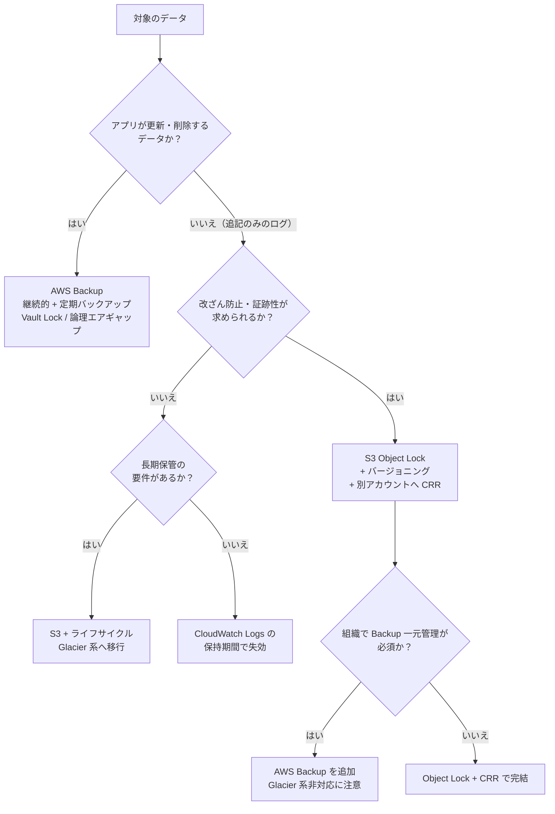

# AWS のログ保管設計 ～ バックアップするログとロックするログの判断基準<!-- omit in toc -->

## ☘️ はじめに<!-- omit in toc -->

本ページは、AWS に関する個人の勉強および勉強会で使用することを目的に、AWS ドキュメントなどを参照し作成しておりますが、記載の誤り等が含まれる場合がございます。

最新の情報については、AWS 公式ドキュメントをご参照ください。

実プロジェクトでログのアーカイブやバックアップを設計していると、「このログは AWS Backup の対象にすべきか」「Object Lock で消せないようにすべきか」「CloudWatch Logs に何日置けばよいか」といった判断で手が止まることがあります。本記事では、基本的な Web アプリケーション構成で出てくるログを対象に、判断の軸と設計例を整理します。

## 👀 Contents<!-- omit in toc -->

- [1. 「アーカイブ」「バックアップ」「イミュータブル保管」は目的が違う](#1-アーカイブバックアップイミュータブル保管は目的が違う)
- [2. 対象とするログと出力先](#2-対象とするログと出力先)
  - [2.1. 追加で検討したいログ](#21-追加で検討したいログ)
  - [2.2. サービス側の保持期間には上限がある](#22-サービス側の保持期間には上限がある)
- [3. ログを 3 つに分類して要件を決める](#3-ログを-3-つに分類して要件を決める)
- [4. CloudWatch Logs の保持期間設計](#4-cloudwatch-logs-の保持期間設計)
  - [4.1. 既定は「失効しない」](#41-既定は失効しない)
  - [4.2. CloudWatch Logs に WORM 機能はない](#42-cloudwatch-logs-に-worm-機能はない)
  - [4.3. S3 への転送方法](#43-s3-への転送方法)
  - [4.4. 保持期間の決め方](#44-保持期間の決め方)
- [5. S3 Object Lock + バージョニング + CRR](#5-s3-object-lock--バージョニング--crr)
  - [5.1. Object Lock の基本](#51-object-lock-の基本)
  - [5.2. 削除マーカーとライフサイクル](#52-削除マーカーとライフサイクル)
  - [5.3. レプリケーション（CRR）との組み合わせ](#53-レプリケーションcrrとの組み合わせ)
  - [5.4. Object Lock で防げないもの](#54-object-lock-で防げないもの)
- [6. AWS Backup で S3 を保護する場合](#6-aws-backup-で-s3-を保護する場合)
- [7. Object Lock + CRR と AWS Backup の使い分け](#7-object-lock--crr-と-aws-backup-の使い分け)
  - [7.1. 監査ログに AWS Backup はほぼ不要](#71-監査ログに-aws-backup-はほぼ不要)
  - [7.2. 判断フロー](#72-判断フロー)
- [8. マルウェアの潜伏期間と保持期間](#8-マルウェアの潜伏期間と保持期間)
  - [8.1. 潜伏期間の統計](#81-潜伏期間の統計)
  - [8.2. ログでは「さかのぼって調査できる期間」として効く](#82-ログではさかのぼって調査できる期間として効く)
  - [8.3. データバックアップでは「クリーンな世代を残す期間」として効く](#83-データバックアップではクリーンな世代を残す期間として効く)
- [9. ログ種別ごとの設計例](#9-ログ種別ごとの設計例)
- [10. 落とし穴](#10-落とし穴)
- [📖 まとめ](#-まとめ)
- [参考資料](#参考資料)

## 1. 「アーカイブ」「バックアップ」「イミュータブル保管」は目的が違う

<!-- Duration: 00:03:00 -->

ログの保管方式で迷う原因の多くは、3 つの目的を区別しないまま「バックアップ」とひとまとめに呼んでいることにあります。

| 目的 | 守りたいもの | 典型的な手段 | 「復元」の概念 |
| --- | --- | --- | --- |
| アーカイブ | 長期間・低コストで残すこと | S3 ライフサイクルで Glacier 系へ移行 | ほぼない（読み出すだけ） |
| バックアップ | 壊れた・消えたデータを過去の時点に戻すこと | AWS Backup、スナップショット | ある（元の場所や別リソースへ戻す） |
| イミュータブル保管 | 削除・改ざんされていないこと | S3 Object Lock、Backup Vault Lock | ない（消えないことが価値） |

アプリケーションのデータは更新され続けるため、誤操作やランサムウェアで壊れた場合に「壊れる前」へ戻す必要があります。これがバックアップの役割です。

一方、ログは基本的に追記のみのデータで、一度書かれたレコードを後から書き換える運用はしません。ログで問題になるのは「壊れること」よりも「消されること」「改ざんされること」「必要な期間が経つ前に失効すること」です。この違いを押さえると、ログに対して AWS Backup が必要になる場面はかなり限られることが分かります。

## 2. 対象とするログと出力先

<!-- Duration: 00:05:00 -->

本記事では、ALB + EC2 / ECS Fargate + Aurora を CloudFront と AWS WAF で公開する、よくある Web アプリケーション構成を想定します。各ログの主な出力先は次のとおりです。

| ログ | 主な出力先 | 補足 |
| --- | --- | --- |
| AWS CloudTrail（証跡） | S3（必須）、CloudWatch Logs（任意） | イベント履歴は証跡がなくても管理イベントを 90 日間参照できる |
| AWS Config | S3（設定履歴・スナップショット） | 設定項目の履歴は Config 内にも保持される |
| Amazon GuardDuty（検出結果） | S3 へのエクスポート、EventBridge | S3 エクスポートには KMS キーが必須 |
| AWS Security Hub CSPM（検出結果） | EventBridge 経由で Firehose → S3 など | ネイティブの S3 エクスポート機能はない |
| Aurora（RDS）のログ | CloudWatch Logs | Aurora MySQL は audit / error / general / slowquery、Aurora PostgreSQL は postgresql など |
| ALB アクセスログ | S3 のみ | バケットの暗号化は SSE-S3 のみ対応 |
| AWS WAF ログ | CloudWatch Logs、S3、Firehose | 出力先の名前は `aws-waf-logs-` で始める必要がある |
| CloudFront 標準ログ | v2: CloudWatch Logs、S3、Firehose / レガシー: S3 | レガシー方式は ACL が有効なバケットが必要 |
| EC2 の OS ログ | CloudWatch Logs（CloudWatch エージェント） | エージェント導入と設定が必要 |
| Session Manager のセッションログ | S3、CloudWatch Logs | セッションの開始・終了 API 自体は CloudTrail に記録される |
| ECS Fargate のコンテナログ | CloudWatch Logs（`awslogs`）、FireLens 経由で Firehose / S3 など | タスク定義のログドライバーで指定する |

💡 Aurora の監査をより厳密に行いたい場合は、データベースアクティビティストリーム（Kinesis Data Streams へ配信）も選択肢になります。

### 2.1. 追加で検討したいログ

インシデント調査では「誰が（CloudTrail）」「どこと通信したか」「何を名前解決したか」を突き合わせることが多いため、次の 2 つも対象に含めることをおすすめします。

| ログ | 主な出力先 | 調査での用途 |
| --- | --- | --- |
| VPC フローログ | CloudWatch Logs、S3、Firehose | 外部 C2 サーバーとの通信や横展開の痕跡を追う |
| Route 53 Resolver クエリログ | CloudWatch Logs、S3、Firehose | 不審なドメインへの名前解決（DNS トンネリング等）を追う |

S3 に重要データを置く場合は、オブジェクト単位の操作を残す CloudTrail の S3 データイベントも検討対象です。S3 サーバーアクセスログもありますが、後述のとおり Object Lock を有効にしたバケットを出力先にできません。

### 2.2. サービス側の保持期間には上限がある

GuardDuty、Security Hub CSPM、CloudTrail のイベント履歴は、何もしなくてもコンソールで過去の情報を参照できます。ただし保持期間には上限があり、延長できません。

| サービス | サービス側での保持 |
| --- | --- |
| CloudTrail イベント履歴 | 管理イベントを 90 日間 |
| GuardDuty | 検出結果を 90 日間 |
| Security Hub CSPM | アクティブな検出結果は最終更新から 90 日、アーカイブ済みは 30 日 |
| AWS Config | 設定項目の履歴を 30〜2,557 日の範囲で設定可能 |

90 日を超えて調査や監査に使う可能性があるなら、S3 へのエクスポートを最初から設計に入れておく必要があります。

## 3. ログを 3 つに分類して要件を決める

<!-- Duration: 00:03:00 -->

ログ種別ごとに個別に悩むより、まず性質の近いものをまとめて要件を決めた方が判断がぶれません。

| 分類 | 該当するログ | 改ざん防止 | 保持期間の目安 | 即時検索性 |
| --- | --- | --- | --- | --- |
| A. 監査・証跡系 | CloudTrail、Config、Session Manager、Aurora の監査ログ | 必須 | 規制・社内規程に従う（1 年以上が多い） | 直近数か月のみ |
| B. セキュリティ分析系 | GuardDuty、Security Hub CSPM、WAF、VPC フローログ、Resolver クエリログ、ALB / CloudFront アクセスログ | 推奨 | 潜伏期間 + 調査期間をカバーする長さ（後述） | 直近数週間〜数か月 |
| C. 運用・トラブルシュート系 | EC2 の OS ログ、ECS アプリログ、Aurora の error / slowquery ログ | 任意 | 障害調査に必要な長さ（数週間〜数か月） | 高い |

分類 A は「消されていない・改ざんされていないことを第三者に示せる」ことが価値の中心です。分類 C は調査が終われば価値が下がるため、保管コストを抑えることを優先します。分類 B はその中間で、セキュリティインシデントの調査材料として、ある程度長く改ざんされずに残っていることが求められます。

基準として PCI DSS v4.0 の要件 10.5.1 がよく引き合いに出されます。監査ログを少なくとも 12 か月保持し、直近 3 か月分はすぐに分析できる状態にしておく、という内容です。準拠対象でなくても、分類 A・B の初期値として「12 か月保持・直近 3 か月はすぐ検索可能」から検討を始めると合意を取りやすくなります。

## 4. CloudWatch Logs の保持期間設計

<!-- Duration: 00:05:00 -->

### 4.1. 既定は「失効しない」

ロググループを作成した時点では保持期間が設定されておらず、ログは無期限に保存されます。RDS のログ発行や ECS の `awslogs` ドライバーが自動作成したロググループも同様です。放置するとストレージ料金が積み上がり続けるため、ロググループ作成時に必ず保持期間を設定する運用にします。

設定できる値は次の 22 段階で、任意の日数は指定できません。

```text
1, 3, 5, 7, 14, 30, 60, 90, 120, 150, 180, 365, 400, 545, 731, 1096, 1827, 2192, 2557, 2922, 3288, 3653（日）
```

```sh
aws logs put-retention-policy \
  --log-group-name /aws/rds/cluster/my-aurora-cluster/audit \
  --retention-in-days 90
```

💡 AWS Config のマネージドルール `cw-loggroup-retention-period-check` を使うと、保持期間が基準（既定は 365 日）より短いロググループを検出できます。ただし保持期間が未設定（失効しない）のロググループは「準拠」と判定されるため、未設定の検出には使えません。未設定を防ぐには、IaC でロググループを明示的に作成し保持期間を指定する運用が確実です。

ロググループには Standard と Essentials（旧称 Infrequent Access）の 2 つのログクラスがあります。Essentials は取り込み料金が安い代わりに、サブスクリプションフィルターやメトリクスフィルター、Live Tail などが使えません。ログクラスは作成後に変更できないため、「S3 へ転送するロググループ」を Essentials にするとサブスクリプションフィルターが使えず困ることになります。

### 4.2. CloudWatch Logs に WORM 機能はない

CloudWatch Logs には、Object Lock のようにログを一定期間削除不可にする機能がありません。`logs:DeleteLogGroup` や `logs:PutRetentionPolicy` の権限を持つプリンシパルであれば、ロググループの削除や保持期間の短縮ができてしまいます。

そのため、改ざん防止が必要な分類 A・B のログについては、CloudWatch Logs を「直近の検索・アラート用」と位置づけ、長期保管と改ざん防止は S3 側で担う構成が基本になります。CloudWatch Logs 側は SCP で削除や保持期間変更を制限しておくと、運用ミスや侵害時の証拠隠滅を防ぎやすくなります。

```json
{
  "Version": "2012-10-17",
  "Statement": [
    {
      "Sid": "DenyLogTampering",
      "Effect": "Deny",
      "Action": [
        "logs:DeleteLogGroup",
        "logs:DeleteLogStream",
        "logs:PutRetentionPolicy"
      ],
      "Resource": "*",
      "Condition": {
        "ArnNotLike": {
          "aws:PrincipalArn": "arn:aws:iam::*:role/LogAdminRole"
        }
      }
    }
  ]
}
```

⚠️ 上記は例です。CDK や CloudFormation でロググループを管理している場合、デプロイ用ロールも除外対象に含めないとスタック更新が失敗します。

### 4.3. S3 への転送方法

CloudWatch Logs から S3 へ移す方法は 2 つあります。

| 方法 | 特徴 | 向いている用途 |
| --- | --- | --- |
| エクスポートタスク（`CreateExportTask`） | 期間を指定して一括エクスポート。データがエクスポート可能になるまで最大 12 時間かかる | 単発の調査、移行時の一括退避 |
| サブスクリプションフィルター + Data Firehose | ほぼリアルタイムで継続的に S3 へ配信 | 継続的なアーカイブ |

AWS ドキュメントでは、エクスポートタスクを継続的なアーカイブ手段として定期実行することは推奨されておらず、サブスクリプションの利用が案内されています。WAF、VPC フローログ、Resolver クエリログ、CloudFront 標準ログ（v2）のように最初から S3 へ直接出力できるログは、CloudWatch Logs を経由せず S3 に出す方がシンプルで安価です。

### 4.4. 保持期間の決め方

CloudWatch Logs の保持期間は「Logs Insights やアラームで日常的に参照する期間」で決め、それより古いものは S3 で保管するという分担にします。目安は次のとおりです。

| 分類 | CloudWatch Logs の保持期間（例） | 長期保管 |
| --- | --- | --- |
| A. 監査・証跡系 | 90 日 | S3（Object Lock） |
| B. セキュリティ分析系 | 90 日 | S3（Object Lock） |
| C. 運用・トラブルシュート系 | 30〜90 日 | 必要なら S3（ロックなし）、不要なら CloudWatch Logs のみ |

分類 C のログに長期保管の要件がなければ、S3 へ転送せず CloudWatch Logs の保持期間で失効させるのが最もシンプルです。

## 5. S3 Object Lock + バージョニング + CRR

<!-- Duration: 00:05:00 -->

### 5.1. Object Lock の基本

S3 Object Lock は、オブジェクトのバージョンを WORM（Write Once Read Many）で保護する機能です。バージョニングが有効なバケットでのみ動作し、一度有効にすると Object Lock の無効化やバージョニングの停止はできません。2023 年 11 月以降は、既存のバケットでも Object Lock を有効化できるようになりました。

保持モードは 2 種類です。

| モード | 保持期間中の削除・上書き | 保持期間の短縮 | 用途 |
| --- | --- | --- | --- |
| ガバナンスモード | `s3:BypassGovernanceRetention` 権限を持つユーザーは可能 | 同権限で可能 | 誤削除防止、設定の試行 |
| コンプライアンスモード | ルートユーザーを含め誰も不可 | 不可（延長のみ可） | 規制対応、改ざん防止の証明 |

保持期間とは別に、期限を持たないリーガルホールドもあります。訴訟や監査で保全が必要になったログに個別に設定し、解除するまで削除できなくする用途に使います。

コンプライアンスモードで保持期間内のオブジェクトを消す方法は、AWS アカウント自体の削除しかありません。最初はガバナンスモードで動作とコストを確認し、問題がなければコンプライアンスモードに切り替える進め方が安全です。

### 5.2. 削除マーカーとライフサイクル

Object Lock が保護するのは「オブジェクトのバージョン」です。バージョン ID を指定しない通常の削除リクエストは成功し、削除マーカーが追加されます。保護されたバージョン自体は残っているため削除マーカーを消せば元に戻せますが、削除マーカー自体は WORM 保護の対象外です。

ライフサイクルルールは Object Lock と併用できます。

- ストレージクラスの移行（Standard → Glacier Flexible Retrieval など）は保持期間中でも実行され、移行後もロックは維持される
- 有効期限切れによる削除は、ロック中のバージョンには適用されない
- 保持期間が切れた後に削除させたい場合は、「非現行バージョンの削除」と「期限切れの削除マーカーの削除」も設定する

Glacier 系のストレージクラスには最低保存期間（Glacier Instant Retrieval / Flexible Retrieval は 90 日、Deep Archive は 180 日）があります。移行のタイミングと保持期間の終わりが近いと、早期削除料金が発生する点に注意します。

### 5.3. レプリケーション（CRR）との組み合わせ

Object Lock だけでは、リージョン障害やアカウント閉鎖に対応できません。保管先を別アカウント・別リージョンへ複製するのが CRR（Cross-Region Replication）です。

Object Lock と CRR を組み合わせる場合の要件は次のとおりです。

| 項目 | 要件 |
| --- | --- |
| バージョニング | 送信元・送信先ともに有効 |
| Object Lock | 送信元で有効なら送信先でも有効にする必要がある |
| IAM ロール | 通常のレプリケーション権限に加えて `s3:GetObjectRetention` と `s3:GetObjectLegalHold` が必要 |
| ロック設定 | レプリカには送信元オブジェクトの保持モード・保持期間が引き継がれる |

レプリケーションはバージョン ID を指定した削除を複製しません。送信元で誰かがバージョンを削除しても、送信先のレプリカは残ります。削除マーカーの複製は設定で選べるため、ログ用途では複製しない設定にしておくと、送信先での見え方が変わりません。

既存オブジェクトは自動では複製されないため、後から CRR を設定する場合は S3 バッチレプリケーションで既存分を複製します。

ログ集約用の専用アカウント（AWS Control Tower の Log Archive アカウントなど）に集め、そこからさらに別リージョンへ CRR する構成にすると、ワークロードアカウントが侵害されても保管済みのログには手が届きません。

### 5.4. Object Lock で防げないもの

Object Lock は削除・上書きを防ぎますが、次のリスクは残ります。

| リスク | 内容 | 対策 |
| --- | --- | --- |
| KMS キーの削除・無効化 | SSE-KMS で暗号化したログは、キーが削除されると読めなくなる | キーポリシーと SCP で `kms:ScheduleKeyDeletion` / `kms:DisableKey` を制限、削除予約を検知 |
| ログ出力の停止 | 既存ログは消えなくても、以降のログが出なくなる | CloudTrail の `StopLogging`、`DeleteTrail`、レプリケーション設定変更を SCP で拒否・検知 |
| バケットポリシーの変更 | 読み取り権限を奪われると調査に使えない | ログアーカイブアカウントへの分離、SCP |
| 出力元が Object Lock バケットに非対応 | S3 サーバーアクセスログは Object Lock 有効バケットを出力先にできない | CloudTrail の S3 データイベントで代替、または別バケット経由 |

ALB アクセスログは出力先バケットの暗号化が SSE-S3 のみサポートされており、SSE-KMS のバケットには出力できません。ALB 用のログバケットは SSE-S3 で作成します。また、サービスが直接 Object Lock バケットへ書き込む構成にする場合は、各サービスのドキュメントで要件を確認し、テスト環境で配信を確かめてから本番に適用してください。

CloudTrail は Object Lock とは別に、ログファイルの整合性検証機能を持っています。有効にすると 1 時間ごとにダイジェストファイル（SHA-256 ハッシュと RSA 署名）が配信され、ログファイルが変更・削除されていないことを AWS CLI で検証できます。Object Lock は「消させない」、整合性検証は「改ざんされていないことを示す」機能なので、監査ログでは両方を有効にします。

```sh
aws cloudtrail validate-logs \
  --trail-arn arn:aws:cloudtrail:ap-northeast-1:111122223333:trail/org-trail \
  --start-time 2026-10-01T00:00:00Z
```

## 6. AWS Backup で S3 を保護する場合

<!-- Duration: 00:03:00 -->

AWS Backup は S3 バケットをバックアップ対象にできます。主な仕様は次のとおりです。

| 項目 | 内容 |
| --- | --- |
| 前提 | バケットのバージョニングが必須 |
| 継続的バックアップ | 過去 35 日以内の任意の時点に復元（PITR） |
| 定期バックアップ | 最長 99 年保持 |
| 対象ストレージクラス | Standard、Standard-IA、One Zone-IA、Glacier Instant Retrieval、Intelligent-Tiering（Glacier Flexible Retrieval と Deep Archive は対象外） |
| コールドストレージ移行 | S3 のバックアップは非対応 |
| バックアップ範囲 | 開始時点の全オブジェクト（非現行バージョン・削除マーカーを含む） |

保護機能として、次の 3 つがあります。

1. Vault Lock: バックアップボールトを WORM 化します。コンプライアンスモードでは最低 3 日（72 時間）の猶予期間が過ぎるとロックを解除できなくなります。
2. 論理エアギャップボールト: コンプライアンスモードのロックが組み込まれたボールトで、AWS RAM で別アカウントに共有して復元できます。
3. Malware Protection: GuardDuty Malware Protection と連携し、EC2・EBS・S3 のリカバリポイントをスキャンします。S3 の継続的バックアップでは、マルウェアが検出されていない最新の時点を特定する API（`GetPITRMalwareScanResults`）も用意されています。

注意したいのは、CloudWatch Logs が AWS Backup の対象リソースに含まれていないことです。CloudWatch Logs のログを保護するには、S3 へ転送してから S3 側で保護する以外の方法はありません。

## 7. Object Lock + CRR と AWS Backup の使い分け

<!-- Duration: 00:05:00 -->

| 観点 | Object Lock + バージョニング + CRR | AWS Backup（S3） |
| --- | --- | --- |
| 守るもの | 個々のログファイルの削除・上書き | バケット全体を過去の時点に戻せること |
| WORM | Object Lock（コンプライアンス / ガバナンス） | Vault Lock、論理エアギャップボールト |
| 別アカウント・別リージョン | CRR で常時複製 | クロスアカウント / クロスリージョンコピー（継続的バックアップのコピーは PITR 不可） |
| Glacier 系への移行 | ライフサイクルで可能、ロックも維持 | Glacier Flexible Retrieval / Deep Archive のオブジェクトは対象外、コールドストレージ移行も不可 |
| 長期保管コスト | Glacier 系で安くできる | ソースバケットと Backup ストレージの二重課金になりやすい |
| 一元管理・監査レポート | 自前で設計（Config ルール、S3 Inventory 等） | Backup Audit Manager、組織単位のバックアップポリシー |
| マルウェアスキャン | 別途 GuardDuty Malware Protection for S3 等を構成 | Malware Protection と統合 |

### 7.1. 監査ログに AWS Backup はほぼ不要

監査・証跡系のログに求められるのは「消えない」「改ざんされていないことを示せる」「必要な期間読める」の 3 点で、「過去の時点に戻す」必要はありません。これらは Object Lock（コンプライアンスモード）、別アカウントへの CRR、CloudTrail の整合性検証で満たせます。

ここに AWS Backup を重ねても、同じログのコピーがもう 1 つ増えるだけです。さらに、ライフサイクルで Glacier Flexible Retrieval / Deep Archive へ移したオブジェクトはバックアップ対象外になるため、長期アーカイブとの相性もよくありません。ログ用バケットについては、Object Lock + バージョニング + CRR を標準とし、AWS Backup の対象から外すのが合理的です。

AWS Backup を検討すべきなのは、次のような場合です。

- 組織のポリシーで「すべての保護対象を AWS Backup で一元管理し、Audit Manager でレポートする」ことが求められている
- S3 に置いているのがログではなく、アプリケーションが更新するデータ（ユーザーのアップロードファイル等）である
- マルウェアスキャン済みの「クリーンな時点」を特定して復元する運用が要件になっている

### 7.2. 判断フロー



## 8. マルウェアの潜伏期間と保持期間

<!-- Duration: 00:05:00 -->

### 8.1. 潜伏期間の統計

攻撃者が侵入してから検知されるまでの期間（ドウェルタイム）について、Mandiant の M-Trends では次の数値が公表されています。

| レポート | 対象年 | 全体の中央値 | 補足 |
| --- | --- | --- | --- |
| M-Trends 2025 | 2024 年 | 11 日 | 外部からの通知で発覚したケースは 26 日、攻撃者自身の通知（ランサムウェア等）で発覚したケースは 5 日 |
| M-Trends 2026 | 2025 年 | 14 日 | サイバー諜報、北朝鮮 IT ワーカー関連のインシデントに限ると中央値 122 日 |

ここで見落としやすいのは、これらが中央値だという点です。半数のインシデントはこれより長く、攻撃の種類によっては中央値でも 4 か月（122 日）に達します。全体の中央値である 2 週間に合わせて保持期間を決めると、検知が遅れたインシデントの多くで調査材料が足りなくなります。

### 8.2. ログでは「さかのぼって調査できる期間」として効く

ログファイル自体がマルウェアに感染して「汚染された世代」になることは、通常ありません。ログにとって潜伏期間が意味するのは「侵入の痕跡が残っている時点までさかのぼれるか」です。

```text
ログの保持期間 ≧ 潜伏期間（侵入〜検知） + 調査・判断期間 + 余裕
```

たとえば侵入から検知まで 6 か月かかった場合、検知時点から 6 か月以上前のログが残っていなければ、初期侵入の経路を特定できません。分類 A・B のログを最低 12 か月保持する設計は、規制対応だけでなく、検知が遅れたインシデントの調査に備える意味もあります。

攻撃者は侵入後に痕跡を消そうとするため、潜伏期間中にログを削除・改ざんされないことも必要です。ここで Object Lock が効きます。

### 8.3. データバックアップでは「クリーンな世代を残す期間」として効く

アプリケーションデータのバックアップでは、潜伏期間中に取得したバックアップにマルウェアや攻撃者の改変が含まれている可能性があります。検知時点で直近のバックアップから戻しても、汚染された状態に戻るだけかもしれません。そのため、潜伏期間より古い「クリーンな世代」が残っている必要があります。

```text
最も古い世代の保持期間 ＞ 想定する潜伏期間 + 検知後の判断期間
```

すべての世代を長期間残すとコストが膨らむため、世代を段階的に間引く構成が一般的です。

| ルール | 頻度 | 保持期間（例） |
| --- | --- | --- |
| 継続的バックアップ（PITR） | 常時 | 35 日 |
| 日次 | 毎日 | 35 日 |
| 月次 | 毎月 1 日 | 12 か月 |

この構成なら、直近 35 日は任意の時点に戻せて、それより前は月単位で 1 年前まで戻れます。AWS Backup の Malware Protection を併用すると、検出のなかった最新の世代を特定しやすくなります。

## 9. ログ種別ごとの設計例

<!-- Duration: 00:05:00 -->

ここまでの内容を、対象ログごとの設計例としてまとめます。保持期間は「12 か月保持・直近 3 か月は即時検索可能」を基準にした一例です。実際の値は、適用される法令・業界基準・社内規程に合わせて決めてください。

| ログ | 分類 | CloudWatch Logs | S3 保管 | Object Lock | CRR | AWS Backup |
| --- | --- | --- | --- | --- | --- | --- |
| CloudTrail（組織の証跡） | A | 90 日（アラート用） | 1 年以上、90 日後に Glacier 系 | コンプライアンス | ○ | 不要 |
| AWS Config | A | - | 1 年以上 | コンプライアンス | ○ | 不要 |
| Session Manager | A | 90 日 | 1 年以上 | コンプライアンス | ○ | 不要 |
| Aurora 監査ログ | A | 90 日 | Firehose 経由で 1 年以上 | コンプライアンス | ○ | 不要（DB 本体は Backup 対象） |
| GuardDuty 検出結果 | B | - | エクスポートで 1 年以上 | ガバナンス〜コンプライアンス | ○ | 不要 |
| Security Hub CSPM 検出結果 | B | - | EventBridge + Firehose で 1 年以上 | ガバナンス〜コンプライアンス | ○ | 不要 |
| AWS WAF | B | 必要な場合のみ | 1 年 | ガバナンス | 任意 | 不要 |
| ALB アクセスログ | B | - | 1 年（SSE-S3） | ガバナンス | 任意 | 不要 |
| CloudFront 標準ログ | B | 必要な場合のみ | 1 年 | ガバナンス | 任意 | 不要 |
| VPC フローログ | B | 必要な場合のみ | 1 年 | ガバナンス | 任意 | 不要 |
| Route 53 Resolver クエリログ | B | 必要な場合のみ | 1 年 | ガバナンス | 任意 | 不要 |
| EC2 の OS ログ | C（認証ログは A 扱いも検討） | 30〜90 日 | 要件があれば | なし | なし | 不要 |
| ECS Fargate アプリログ | C | 30〜90 日 | 要件があれば | なし | なし | 不要 |
| Aurora error / slowquery | C | 30〜90 日 | 要件があれば | なし | なし | 不要 |

EC2 の OS ログのうち、`/var/log/secure` などの認証ログは侵害調査で重要な証跡になります。運用ログと同じロググループにまとめず、分類 A と同じ扱いで S3 に保管することも検討してください。

ログ用バケットは、保持要件ごとにバケットを分けると管理しやすくなります。Object Lock のデフォルト保持期間はバケット単位で設定するため、コンプライアンスモードで長期保持するログと、ガバナンスモードで 1 年保持するログを同じバケットに混ぜると、後から個別に調整する手間が増えます。

## 10. 落とし穴

<!-- Duration: 00:03:00 -->

### コンプライアンスモードの設定ミスは取り消せない<!-- omit in toc -->

保持期間を誤って 10 年に設定すると、10 年間は誰も削除できず、その間のストレージ料金を払い続けることになります。AWS Backup の Vault Lock も、猶予期間（最低 3 日）が過ぎると解除できません。本番適用前にガバナンスモードで検証し、ライフサイクルと合わせたコスト試算を済ませておきます。

### 個人情報を含むログは「消せない」ことが問題になる<!-- omit in toc -->

アクセスログやアプリログには IP アドレスやユーザー ID が含まれます。プライバシーポリシーや契約で保存期間の上限や削除要請への対応が定められている場合、コンプライアンスモードで長期ロックすると、その義務を果たせなくなる可能性があります。保持期間の上限も、下限と同じように確認しておきます。

### サービス側の 90 日制限に気づかない<!-- omit in toc -->

GuardDuty や Security Hub CSPM の検出結果は、何もしなければ 90 日で消えます。インシデント発覚後にエクスポートを設定しても、それ以前の検出結果は戻りません。

### CloudTrail Lake は新規受付を終了している<!-- omit in toc -->

CloudTrail Lake は 2026 年 5 月 31 日をもって新規顧客の受付を終了しました。これから長期保管と検索を設計する場合、CloudTrail Lake は前提にできません。AWS は代替として CloudWatch を案内しています。従来の証跡（Trails）は影響を受けません。

## 📖 まとめ

ログの保管設計では、まず「アーカイブ」「バックアップ」「イミュータブル保管」を区別し、ログの性質ごとに必要なものを選びます。

- 追記のみのログに必要なのは「戻す」ことではなく「消えない・改ざんされない・必要な期間読める」こと。監査・証跡系のログは S3 Object Lock + バージョニング + 別アカウントへの CRR で要件を満たせ、AWS Backup は原則不要
- CloudWatch Logs は既定で無期限保存、WORM 機能なし、AWS Backup の対象外。「直近の検索・アラート用」として保持期間を区切り、長期保管と改ざん防止は S3 側に任せる
- マルウェアの潜伏期間は、ログでは「さかのぼって調査できる期間」、データバックアップでは「クリーンな世代を残す期間」として効く。中央値（11〜14 日）ではなく、検知が遅れるケースを前提に決める
- GuardDuty・Security Hub CSPM・CloudTrail イベント履歴のサービス側保持は 90 日まで。長期間必要なら最初からエクスポートを設計に入れる

## 参考資料

- AWS ドキュメント > [Locking objects with Object Lock](https://docs.aws.amazon.com/AmazonS3/latest/userguide/object-lock.html)
- AWS ドキュメント > [Object Lock considerations](https://docs.aws.amazon.com/AmazonS3/latest/userguide/object-lock-managing.html)
- AWS ドキュメント > [Requirements and considerations for replication](https://docs.aws.amazon.com/AmazonS3/latest/userguide/replication-requirements.html)
- [Amazon S3 now supports enabling S3 Object Lock on existing buckets](https://aws.amazon.com/about-aws/whats-new/2023/11/amazon-s3-enabling-object-lock-buckets)
- AWS ドキュメント > [Amazon S3 backups（AWS Backup）](https://docs.aws.amazon.com/aws-backup/latest/devguide/s3-backups.html)
- AWS ドキュメント > [AWS Backup Vault Lock](https://docs.aws.amazon.com/aws-backup/latest/devguide/vault-lock.html)
- AWS ドキュメント > [Logically air-gapped vault](https://docs.aws.amazon.com/aws-backup/latest/devguide/logicallyairgappedvault.html)
- AWS ドキュメント > [Malware protection in AWS Backup](https://docs.aws.amazon.com/aws-backup/latest/devguide/malware-protection.html)
- AWS ドキュメント > [AWS Backup feature availability](https://docs.aws.amazon.com/aws-backup/latest/devguide/backup-feature-availability.html)
- AWS ドキュメント > [PutRetentionPolicy（CloudWatch Logs）](https://docs.aws.amazon.com/AmazonCloudWatchLogs/latest/APIReference/API_PutRetentionPolicy.html)
- AWS ドキュメント > [Log classes（CloudWatch Logs）](https://docs.aws.amazon.com/AmazonCloudWatch/latest/logs/CloudWatch_Logs_Log_Classes.html)
- AWS ドキュメント > [Exporting log data to Amazon S3](https://docs.aws.amazon.com/AmazonCloudWatch/latest/logs/S3Export.html)
- AWS ドキュメント > [Validating CloudTrail log file integrity](https://docs.aws.amazon.com/awscloudtrail/latest/userguide/cloudtrail-log-file-validation-intro.html)
- AWS ドキュメント > [CloudTrail Lake availability change](https://docs.aws.amazon.com/awscloudtrail/latest/userguide/cloudtrail-lake-service-availability-change.html)
- AWS ドキュメント > [Enable access logs for your Application Load Balancer](https://docs.aws.amazon.com/elasticloadbalancing/latest/application/enable-access-logging.html)
- AWS ドキュメント > [Publishing database logs to Amazon CloudWatch Logs](https://docs.aws.amazon.com/AmazonRDS/latest/UserGuide/USER_LogAccess.Procedural.UploadtoCloudWatch.html)
- AWS ドキュメント > [Configure standard logging (v2)（CloudFront）](https://docs.aws.amazon.com/AmazonCloudFront/latest/DeveloperGuide/standard-logging.html)
- AWS ドキュメント > [Exporting generated GuardDuty findings to Amazon S3 buckets](https://docs.aws.amazon.com/guardduty/latest/ug/guardduty_exportfindings.html)
- AWS ドキュメント > [Creating and updating findings in Security Hub CSPM](https://docs.aws.amazon.com/securityhub/latest/userguide/securityhub-findings.html)
- AWS ドキュメント > [PutRetentionConfiguration（AWS Config）](https://docs.aws.amazon.com/config/latest/APIReference/API_PutRetentionConfiguration.html)
- AWS ドキュメント > [cw-loggroup-retention-period-check（AWS Config）](https://docs.aws.amazon.com/config/latest/developerguide/cw-loggroup-retention-period-check.html)
- [M-Trends 2025（Google Cloud Blog）](https://cloud.google.com/blog/topics/threat-intelligence/m-trends-2025)
- [M-Trends 2026（Google Cloud Blog）](https://cloud.google.com/blog/topics/threat-intelligence/m-trends-2026/)
